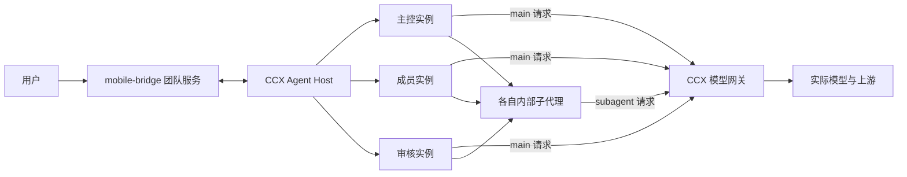

# CCX Agent 设计方案

日期：2026-11-21。状态：设计已完成，供评审；运行时与 CCX 扩展未实施。

## 1. 目标与角色边界

实现一个可独立使用、可接入 mobile-bridge、通过 CCX 调用模型的统一 Agent 运行时。主控、成员、审核使用同一实现，通过角色提示、工具权限及会话配置形成分工。

**团队角色与内部调用层级完全独立。** 工作成员负责完整任务时使用自己的主模型；只有它主动委派内部子代理，后者才使用子模型并被 CCX 识别为 subagent。

| 实例 | teamRole | 调用层级 | 默认模型来源 |
| --- | --- | --- | --- |
| 团队负责人 | lead | main | 该主控会话的主模型 |
| 工作成员 | member | main | 该成员会话的主模型 |
| 独立审核 | reviewer | main | 该审核会话的主模型 |
| 任一角色内部委派的子代理 | 继承所属团队角色 | subagent | 所属会话的子模型 |

主模型与子模型都可选择强模型；“子”表达委派关系，不自动等于便宜或快速。子模型可以按角色和任务独立配置，Agent 决定是否需要委派，主控可通过任务契约禁止或限制委派。

首版目标：明确选模启动会话、三类角色、内部子代理、主控异步调度与追加信息、可控并发、完整恢复、CCX 策略协同。角色支持不等于质量承诺，实际规划、实现和审核质量须用真实任务评估。

## 2. 架构与实现基础

暂称 `ccx-agent`，作为独立包开发，通过适配层接入现有项目。推荐复用 Pi SDK v1.6.0 的模型循环、工具与会话基础，自建控制和策略层；本轮只设计，此技术选择尚未完成原型验证。



- **mobile-bridge**：外层 Team/Run/Task、工作区锁、验收、团队预算；继续使用现有账本。
- **Agent Host**：拥有多会话、内部子代理、消息与模型配置、模型请求并发，向外提供 ACP 和控制 RPC。
- **Pi kernel adapter**：创建独立 SDK session，传入明确 cwd/model/settings/tools，保持完整消息与工具结果；避免依赖 Pi 全局活动模型。
- **CCX adapter**：选择原生协议、添加调用层级标记，报告请求模型与实际模型，复用 CCX 映射和故障转移。

内核调用接口只覆盖 create/prompt/steer/follow-up/abort/state/events。工具通过既有内核运行，团队工具转调现有服务，不另外构建通用插件框架。

团队所有根会话及其内部子代理连接同一 Host，才能统一限制并发。CLI 单独运行时可使用嵌入 Host；多个互不相连的独立 CLI 实例不宣称共享团队并发限制。

ACP 子进程可作为连接 Host 的轻量代理，以适应现有 Manager 每会话启动一个进程的方式。会话执行 owner 位于 Host；代理断开不意味着任务完成或可重复启动。

独立 CLI 的 Lead 可以通过 Host 本地执行任务后端管理成员根实例；连接 mobile-bridge 时，同一工具接口固定转调 Team 服务。一次 Run 固定任务 owner，断连不自动切到本地另起任务。本地后端复用 Host 的执行记录，不复制 mobile-bridge 的需求、契约和工作项产品层。

## 3. 收到任务后的默认工作流

采用“主模型定探索方向 → 子代理收集证据 → 主模型核验并完成方案”的流程。它适合复杂任务；简单问答、已明确的单点修改和已有充分证据的任务可以直接处理，避免强制多次交接。

| 阶段 | 执行者 | 输出与边界 |
| --- | --- | --- |
| 初步规划 | 当前角色的主模型 | 明确目标、完成条件、已知约束和待查问题；形成探索任务，不提前固化实现方案 |
| 定向探索 | 一个或少量内部子代理，使用子模型 | 读取入口、调用路径、相关文件、项目约定和测试；默认只读，不修改代码 |
| 证据核验 | 主模型 | 复核关键原文、调用关系和约束；区分事实、推断与未知，必要时有限追加探索 |
| 方案收束 | 主模型 | 确定方案、范围、取舍、风险、验证方式和任务分工 |
| 后续执行 | 按任务目标与团队角色执行 | 设计任务可以在此完成；实施任务继续执行与验证，不能把方案完成当作实施完成 |

探索包至少包含：任务问题、相关文件/符号、源码引用及读取版本、约束来源、现有测试入口、未确认问题和建议续读位置。摘要应索引原始证据；主模型可以按引用续读完整片段。

默认按“入口与调用关系”“约束与现有测试”等互不重叠的问题分派，探索并发受同一 Host 预算限制。子代理提供建议，主模型保留方案决策权；探索结果不改变用户目标或工具授权。

| 难点 | 处理方式 |
| --- | --- |
| 子模型漏读或误读关键约束 | 主模型核验关键入口、项目约定和风险点；无证据的问题保持未知 |
| 摘要丢失细节、文件已变化 | 保留可续读引用与文件指纹；关键文件变化时重新核验相关结论 |
| 多次调用增加成本和延迟 | 限制探索数量、期限与上下文，为主模型保留收束预算；简单任务跳过探索 |
| 初步规划形成锚定偏差 | 初稿是待验证假设；遇到反例必须修订，不能要求子代理只寻找支持证据 |
| 子代理不断递归探索 | 默认探索阶段只允许一层；追加探索由主模型在预算内决定 |
| 方案看似完整但不可执行 | 收束时逐项对应完成条件、文件范围、检查命令与未解决约束 |

主控、工作成员和审核都可使用这个流程：主控探索任务分工与依赖，成员探索实现边界，审核探索改动与验证证据。它们自己的初步规划和方案收束均属于 main 请求，内部探索才属于 subagent。

## 4. 会话配置与 CLI

以下命令与字段是拟实现的接口，当前仓库没有 `ccx-agent` 可执行文件。

```sh
ccx-agent run --role member --cwd "/project/path" \
  --base-url "http://CCX_HOST:PORT" --api-key-env CCX_API_KEY \
  --protocol responses --model "MAIN_MODEL_ID" \
  --sub-protocol chat --sub-model "SUB_MODEL_ID" \
  --model-policy requested --session "SESSION_ID" "完成给定任务"
```

主控或审核只改变 role 和所选模型：同一个运行时都能先规划、委派探索、再用主模型收束。模型 ID 可以是 CCX 已配置别名，不能根据角色名称猜测实际模型。

任务执行配置示意：

```json
{
  "teamRole": "member",
  "main": {"model": "MAIN_MODEL_ID", "protocol": "responses", "thinking": "high"},
  "subagent": {"model": "SUB_MODEL_ID", "protocol": "chat", "thinking": "low", "maxConcurrency": 2, "maxDepth": 1},
  "modelPolicy": "requested",
  "toolPolicy": "project-write",
  "keySource": {"env": "CCX_API_KEY"}
}
```

本地优先级：显式任务参数 → 成员执行配置 → 当前会话配置 → 应用默认值；最终结果必须受用户授权的模型、工具和预算上限限制。CCX 的模型覆盖规则另见第 7 节。

每个外层任务冻结一份有效配置和版本。主控可为不同任务分别指定主/子模型；不会修改其他成员的全局配置。内部子代理创建时冻结继承配置，不随父会话后来改默认值而悄悄换模型。

恢复会话默认使用其保存配置；显式改模通过受控配置操作处理。可读状态同时报告 requested 模型、配置来源、CCX 策略模式和最近一次已观测的 actual 模型，未知值保持未知。

默认先支持 Responses 与 Chat；子代理可以使用不同协议，因为它有自己的新会话和上下文。主会话的密文、签名和 provider 专用续聊状态不能直接塞进异协议子会话。

密钥只保存引用，运行时从环境或用户配置读取；不写入会话正文、CLI 参数回显和任务 journal。模型能力、上下文与思考档位按实际配置验证，配置失败不静默改用其他模型。

子代理上下文按子模型可证明的窗口裁剪，保留引用而非复制整个主会话。网关托管模型能力未知时使用明确的保守上限或拒绝超限输入，不能沿用主模型窗口假定子模型也能接收。

## 5. 主控与内部子代理工具

给主控提供少量结构化工具，后端复用现有 Team 服务。名称为设计示意：

| 工具 | 行为 |
| --- | --- |
| `team_assign` | 给某角色/成员创建任务，附主模型、子模型、约束、完成条件和预算 |
| `team_status` | 查询成员、任务、在途状态和等待原因 |
| `team_update` | 向精确任务追加信息，选择 steer/follow-up/interrupt |
| `team_cancel` | 请求停止任务，查询停止确认及遗留副作用 |
| `team_set_parallelism` | 在用户上限内调整当前调度并发 |
| `team_result` | 获取当前版本的结果、差异与验证证据 |

工具响应带 Team/Run/Task ID、操作 UUID、版本和 accepted/rejected/unknown 等真实状态。派发立即返回受理结果，不等成员执行完；成员事件以持久游标交回主控，主控忙时下一轮读取、闲时可以触发有界续轮。

Lead 的团队派发与成员内部委派有不同归属：前者创建根任务、执行根实例的主模型；后者创建该实例内部的子代理、使用子模型。Lead 给自己分派实施任务时，也使用独立执行会话，保留控制会话的响应能力。

接入时需调整现有 Lead 简报：允许控制会话及其内部子代理只读探索、核验关键证据；文件修改和实质实施仍通过独立成员任务执行。否则旧简报会与本方案默认探索流程冲突。

内部工具包括 `agent_delegate`、`agent_status`、`agent_result`、`agent_message`、`agent_cancel`。delegate 明确问题、所需上下文引用、输出要求、工具子集和预算；仅能管理当前根会话的后代。工具名使用跨协议可接受的字母、数字与下划线。

探索默认使用已配置的子模型且只读。必要时可选择已授权的主模型配置处理复杂内部子任务；此时调用关系仍是 subagent，不因用了强模型改成 main。

子代理结果返回结构化证据包和原始会话引用。父模型可续读、追问与有限重试，不能将摘要当成完整历史；父任务最终结算前必须收齐后代终态，或明确报告尚有未结清工作。

主控调用外层团队工具保持异步；成员内部等待子结果时不占模型请求名额。工具等待与网络请求的并发分开计算，避免等待自身子任务造成死锁。

## 6. 并发与资源调度

分开限制三个量：外层正在执行的根任务数、每根会话的内部子代理数、Host 实际模型请求数。不能用“有几个 Agent”代替“同时发出几个模型请求”。

配置例：最多 3 个成员任务，每根最多 2 个子代理，Host 最多 6 个模型请求；内部委派不会自动把实际模型并发扩大到 3×2 或更多。角色名称不决定资源档位。

- 外层任务准入继续由 Team 服务负责；内部后代准入与模型请求准入由同一 Host 管理。
- root 正在等待子结果时可以仍占团队任务名额，但不占模型请求名额；子代理不会再申请外层根任务名额。
- 模型请求名额只覆盖实际 provider 请求生命周期，包括流式消费；必须在 stream 结束/取消后的 finally 归还。
- Pi 的 `after_provider_response` 在收到 HTTP 响应后、消费流之前触发，不能在此释放名额。头部 Hook 用于添加身份；并发限制须包住实际 transport/stream 生命周期。
- 重试、压缩和辅助模型请求都经过同一准入层；不允许 SDK 背景调用绕过统计。
- 为 Lead 控制会话保留模型容量，默认总容量≥2时保留1个名额；总容量为1时按控制请求优先排队，不永久占住唯一名额。
- 多根会话之间采用公平排队；一个成员大量探索不能长期阻塞其他成员和审核。

主控调整的是当前 Run 的软并发值，硬上限由用户配置确定。软值、操作 UUID 和版本进入 Run journal，重启后恢复；无需为上限内的日常调整反复询问用户。

从3降到1：已运行任务继续结算，停止新准入，直到在途数降到1；不会暗中终止两个任务。提高软并发不能超过用户硬上限，实际请求仍须经过 CCX 的额度与限流检查；额度状态未知时不能假称已获得上游容量。

探索阶段另有数量、期限、递归深度和证据长度上限，并保留主模型完成核验/方案的预算。预算耗尽时返回部分证据和未完成问题，不能吞掉主模型收束阶段。

Agent Host 限制本团队受管理的请求；CCX 仍负责共享上游的 Key、限流、健康与故障转移。Agent 不自行选择新上游绕开网关策略，也不把网关重试假装成另一个已完成任务。

## 7. CCX 接入与模型优先级

需要给 CCX 增加少量客户端无关的元数据支持。下列新字段是设计提案，当前 CCX 没有实现；已有 Codex/Claude Code 识别路径继续兼容。

| 字段 | 用途 |
| --- | --- |
| `Session_id` | 复用已有提取规则；根会话与每个子会话各有稳定 ID |
| `X-CCX-Agent-Scope` | main/subagent；由运行时根据委派关系生成 |
| `X-CCX-Parent-Session-Id` | 内部子代理的父会话引用 |
| `X-CCX-Team-Role` | lead/member/reviewer，仅观测，不能用于子代理路由 |
| `X-CCX-Model-Policy` | gateway/requested，定义默认模型覆盖行为 |
| `X-Client-Request-Id` | 复用请求关联 ID，与会话 ID 分开 |

CCX 只把 scope=subagent 的内部调用标为精确子代理。根实例无论是负责人、成员或审核，scope 均为 main。使用子模型 ID 也不自动改变 scope。

两种模型模式：

- **gateway**：内部委派采用 CCX 该协议的子代理默认模型；未配置默认模型时保持请求模型。Agent 报告模型来源为网关，不假称本地值已经是实际模型。
- **requested**：保留 Agent 明确指定的主/子请求模型，不应用子代理“默认模型替换”；仍执行子代理参与集合、模型映射、已配置回退、Key/模型权限、限流和健康规则。

requested 的目的只是使角色任务的明确选模有效，不能借此访问未授权模型或绕开渠道策略。未发送新字段的客户端保持原行为；不要自动清空用户现有 CCX 子代理配置。

拟增加使用代理鉴权的只读能力查询 `GET /v1/ccx/capabilities`，声明 scope 与 requested-mode 支持。严格模式不支持时提前拒绝；普通兼容模式可运行显式模型，但必须显示“内部子代理路由未接通”。

实际响应拟附 `X-CCX-Model-Policy-Applied` 与 `X-CCX-Effective-Model`，只在最终选路成功后报告。Alias、默认覆盖、映射与回退后的实际模型分别记录；Agent 校验模式是否真正生效，不能只凭配置保存成功作判断。

这些 CCX 专用字段由网关消费，并在上游头部准备时移除。保持同协议原生 payload 语义；协议转换继续由现有 CCX provider 层负责，Agent 不伪装成 Codex/Claude Code。

加密/签名续聊仍固定兼容来源，requested 模式也不解除这一限制。切到不兼容模型时创建新执行会话并转交必要上下文，保留原任务关联，不剥除密文或假装无损恢复。

## 8. 追加信息、恢复与权限

| 操作 | 语义 |
| --- | --- |
| steer | 追加到当前任务，在当前工具调用结束、下次模型请求前交付；不撤回已执行工具 |
| follow-up | 当前任务结束后执行；排队身份和内容持久化 |
| interrupt | 先确认停止，再以任务修订继续；停止未知时停靠，不自动重发 |
| set-models | 原子设置主/子模型；默认要求空闲，可明确排到下一轮；不改变在途请求或既有子会话 |
| cancel | 先清除该任务待续消息，再停止根与后代，等待真实停止确认 |

控制请求携带 operationId、expectedTaskId、expectedGeneration 和配置/Run 版本。重复操作同内容返回已有结果，内容变化拒绝；晚到消息不能追加到已换代的下一任务。

接收消息、运行消息和完成任务是不同事件。任务完成需满足目标对应的交付与验证；`idle`、`prompt accepted` 或“方案已写好”不作为实施成功的充分证据。

Host 持久化根/子会话身份、父关系、冻结配置、完整消息与工具回执、队列、版本、事件游标和未知操作。外层任务事实保存在 Team journal；Host 只存执行与内部委派事实，不重复维护 Team Task 账本。

恢复必须使用内核的持久 SessionManager 重建模型上下文；不存在的会话报错，目录不匹配报错，禁止创建空会话冒充恢复。每会话只允许一个执行 owner，重新接入采用 generation/lease 防止第二写入者。

工具副作用确认后写入回执；网络断开、进程退出或停止超时导致结果未知时，不自动重放文件写入和命令。恢复先对账，再继续未执行部分。

授权规则：内部子代理工具权限 = 用户授权 ∩ 根角色权限 ∩ 当前任务范围 ∩ 子代理工具请求。审核角色的后代继承只读上限，换模型不能扩大权限。

探索阶段固定只读；实施阶段可在授权范围内委派小任务。首版同工作区写工具串行，并继承外层任务的工作区 lease；独立写工作区复用用户预备的 Team workspace，避免绕过既有锁。

MCP、Skills、项目约定通过受控资源加载器明确加载。Pi SDK 不自动加载 CLI 的 MCP 扩展，需要显式接入并纳入同一权限与并发管理；不能依赖宿主默认工具证明角色隔离。

## 9. 接入步骤与验收

以下阶段全部待实施；本轮产出是设计文档。

1. **内核与会话**：独立 CLI/Host、Pi adapter、三类角色配置、主/子模型参数、持久消息及恢复、标准工具与事件。
2. **内部工作流**：初步规划、只读探索、证据核验、主模型收束；内部委派、信息追加、取消、公平并发和控制容量预留。
3. **CCX 契约**：中立 scope、requested/gateway 模式、能力查询、实际模型回执；复用当前渠道、权限、映射与续聊保护。
4. **mobile-bridge 接入**：新增真实可发现的 Agent profile；ACP new/load/prompt/cancel/model/config option 与 steer 扩展；任务执行配置和主控工具接到现有 Team 服务。
5. **真实任务评估**：在受控项目中验证实现、审核和持续指挥，比较直接主模型与默认探索工作流的质量、延迟和成本。

初期目录建议保持简单：`src/kernel/pi`、`src/runtime`、`src/ccx`、`src/transports`、`src/tools`、`src/store` 与 `test`。不 fork 整个 Pi/Snow，不同时构建新聊天 UI 或新网关调度器。

| 必须通过的验收 | 核验方式 |
| --- | --- |
| lead/member/reviewer 根请求都用各自主模型与 main scope | 请求捕获＋配置读回 |
| 各角色内部委派用指定子模型与 subagent scope | 请求捕获＋父关系与实际模型回执 |
| CCX 非空全局子模型不覆盖 requested 模式，gateway 模式继续覆盖 | 四类文本协议相关路径测试；首版先完成 Responses/Chat |
| 主模型先定探索问题，子代理提供证据，主模型完成设计 | 事件序列＋证据引用；简单任务验证跳过路径 |
| 子代理漏掉约束或提供错误引用时，主模型不直接采信 | 故障样例与真实任务对照 |
| 根与后代同时请求时不突破模型并发上限，主控仍能响应 | 阻塞流、排队、软上限调整、主控预留容量测试 |
| steer 在指定任务边界交付；过期任务/generation 拒绝追加 | 并发与交接窗口测试 |
| cancel 清除待续任务，并收齐根、后代、工具和审批状态 | 取消与断连故障注入 |
| 恢复不存在会话失败，完整工具历史与配置能恢复 | 跨进程恢复测试 |
| 密文/签名续聊不被随意改模型或来源 | HTTP/WS 及不兼容切换测试 |
| reviewer 的内部后代无法扩大写权限，写任务遵守外层 lease | 工具权限和工作区竞争测试 |
| 未知结果不自动重复执行副作用，真实验证未通过不结算成功 | journal 重放与结果归因测试 |

协议/故障路径先用受控服务验证，再进行真实模型评估。固定相同任务与模型，记录总时长、主/子调用次数、费用、关键约束遗漏、方案可执行性、纠偏次数和最终检查结果；不把“调用了子代理”当成性能提升证据。

运行时与前端接入时，按对应仓库执行构建、测试及环境 preflight。需要加载改动时遵守现有网关重启约定；本次没有安装、运行或部署新 Agent。

## 10. 依据与设计取舍

当前源码阅读基线：mobile-bridge `493284df`；CCX lean worktree `fcb5ec72`。CCX 有无关未提交改动，本轮只读；本轮仅修改 mobile-bridge 中的设计/调研文档。

关键依据：

- [团队队列端口](../internal/team/ports.go)：已有任务账本接入，同时仍直接依赖 ACP runtime；新 Agent 先通过 ACP 适配，不重写团队系统。
- [任务派发与执行会话](../internal/httpd/teams_adapter.go)：可复用成员绑定、专用 Lead 执行会话与设置继承。
- [现有异步任务控制](team-async-orchestration-quality-plan.md)：已有查询、更新、事件和未知结果处理，作为主控工具的后端依据。
- [CCX 子代理策略条件](/Users/petaflops/works/api-gateways/llm-routing/ccx-v3-lean/backend-go/internal/config/subagent_routing.go:98)：只对 exact subagent 应用当前全局策略。
- [CCX 角色提取](/Users/petaflops/works/api-gateways/llm-routing/ccx-v3-lean/backend-go/internal/utils/headers.go:112)：当前没有本文拟议的中立 scope/requested 契约。
- [CCX 续聊来源保护](/Users/petaflops/works/api-gateways/llm-routing/ccx-v3-lean/backend-go/internal/scheduler/subagent_routing.go:12)：模型切换需要尊重实际成功来源。
- [Pi v1.6.0 SDK](https://github.com/earendil-works/pi/blob/v1.6.0/packages/coding-agent/docs/sdk.md)：支持独立 model/settings/session/tools、事件、steer/follow-up/abort；SessionManager 是持久上下文依据。
- [Pi v1.6.0 扩展](https://github.com/earendil-works/pi/blob/v1.6.0/packages/coding-agent/docs/extensions.md)：支持逐请求头部 Hook、自定义工具与工具拦截；响应头事件早于流结束。

复用成熟内核减少多协议消息、工具循环、压缩和历史恢复的维护负担；自建层聚焦角色配置、内部委派、控制接口、预算和 CCX。独立 kernel adapter 给后续替换保留边界，但首版只实现一种内核。

现有代理的比较与 Snow 只读检查见 [候选调研](2026-11-21-team-agent-selection.md) 和 [CCX/Snow 评估](2026-11-21-ccx-snow-agent-fit.md)。此前关于工作成员进入子代理池的建议已按用户澄清修正：工作成员的根请求使用自己的主模型，内部委派才使用子代理策略。

本轮没有实现 CLI、Host、工具或 CCX 新字段，也没有执行真实模型任务。本文中的命令、字段、接口和验收是拟实现契约，不能当作当前产品已支持的能力。
