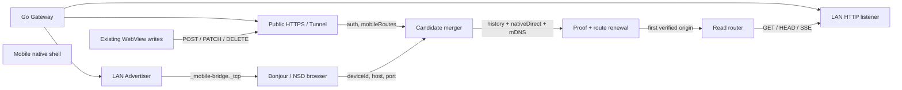
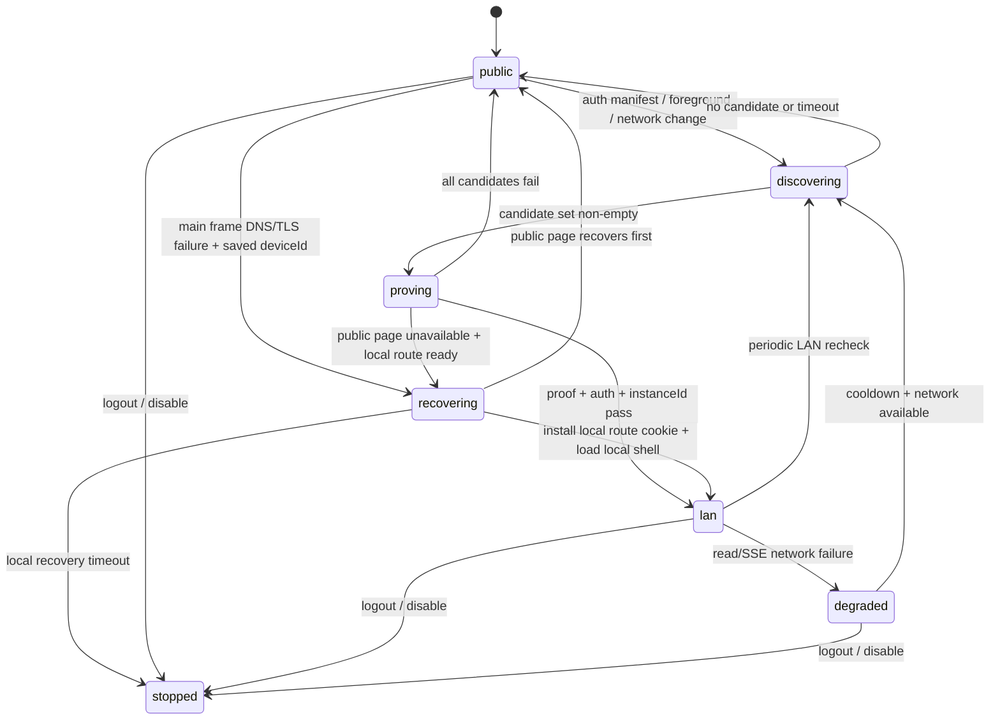

# Blurt 风格网内发现与快速连接实现设计

状态：设计提案

日期：2026-11-13

关联研究：[Blurt 网内连接、发现与传输学习报告](blurt-lan-gateway-study.md)

## 目录

1. [设计结论](#1-设计结论)
2. [范围、目标与非目标](#2-范围目标与非目标)
3. [现有基础与约束](#3-现有基础与约束)
4. [目标架构](#4-目标架构)
5. [DNS-SD 服务契约](#5-dns-sd-服务契约)
6. [候选端点与安全验证](#6-候选端点与安全验证)
7. [连接状态机](#7-连接状态机)
8. [各端实现方案](#8-各端实现方案)
9. [数据、配置与兼容性](#9-数据配置与兼容性)
10. [测试与验收](#10-测试与验收)
11. [分阶段实施与回滚](#11-分阶段实施与回滚)
12. [文件变更清单](#12-文件变更清单)
13. [待决事项](#13-待决事项)

## 1. 设计结论

本项目应实现 Blurt 方案中最适合网关的四项能力，并把“公网入口不可用时的局域网启动恢复”作为同一功能的核心路径：

1. 网关通过 DNS-SD 广播稳定的 `DeviceID` 与现有 LAN 端口。
2. Android 与 iOS 将 DNS-SD 结果作为候选来源，与历史地址、`nativeDirect` 和 `mobileRoutes.endpoints` 并行竞速。
3. 候选先通过现有 ownership proof 和路由级凭据流程，再允许读取 LAN API。
4. 手机根据上次成功连接保存的 `DeviceID` 和局域网 origin，在公网域名失败时直接浏览 DNS-SD，成功后从局域网 origin 启动 WebView。

聊天消息、审批、Goal、文件写入和任务提交继续使用现有 HTTP/SSE 与幂等账本，不移植 Blurt 的 UDP 媒体通道。这样可以改善 DHCP 换址、热点切换、网关重启以及“外网不可用但手机热点与电脑同网段”时的恢复速度，同时不改变提交幂等语义。

首个实现版本默认关闭 DNS-SD 广播，通过配置和客户端能力开关逐步启用。关闭开关后，客户端继续使用当前公网与 `nativeDirect` 路径，不需要数据迁移。

## 2. 范围、目标与非目标

### 2.1 实现目标

- 局域网 IP 因 DHCP、热点或网卡变化后，已配对手机能在一个发现周期内找到网关。
- 历史地址、DNS-SD、静态入口和公网入口互相独立；任一路径慢或失效都不阻塞其他路径。
- 首个成功候选必须同时满足设备身份、当前运行实例和所有权证明，不能以 TCP 可达作为成功条件。
- 正常公网模式下，LAN 只承接 GET/HEAD、图片、附件和 SSE；写请求保留现有公网链路与结果未知处理。
- 发现服务停止、权限被系统拒绝、DNS-SD 不可用时，现有手动地址和公网访问继续可用。
- 已有连接记录且公网域名不可达时，原生层不等待 WebView 错误页，直接用历史 `DeviceID` 过滤同网关的 DNS-SD 服务并尝试局域网启动。
- 记录发现来源和耗时，能区分“未发现”“发现但 proof 失败”“验证成功后请求失败”。

### 2.2 非目标

- 不建立新的聊天、审批、Goal 或文件上传协议。
- 不把根 Cookie、CSRF、路由 Cookie 或 Tunnel Token 放入 TXT 记录、缓存文件或 URL。
- 不对局域网网段主动扫描，不根据电脑名或端口猜测网关。
- 不在第一阶段实现 Blurt 的音视频编码、UDP 打洞、FEC、NACK 或远控输入。
- 不把 DNS-SD 视为信任根；局域网内伪造服务、主动代理和 HTTP 窃听仍需通过 HTTPS 或后续应用层加密解决。

### 2.3 可实现性判断

| 能力 | 判断 | 实现方式 | 首次版本 |
| --- | --- | --- | --- |
| 网关 DNS-SD 广播 | 可实现 | Go 广播适配器，绑定现有 LAN listener | P0 |
| Android DNS-SD 浏览 | 可实现 | `NsdManager`，接入 `DirectTransport` | P0 |
| iOS Bonjour 浏览 | 可实现 | `NWBrowser`，接入 `ConnectionDiscovery` | P0 |
| 候选并发竞速 | 已有基础 | 扩展现有 `EndpointSelector`，加入 generation | P0 |
| proof 后再发凭据 | iOS 已有模式，Android 需补齐 | 复用 `/api/connection/prove` 与 route renewal | P0 |
| 公网域名失败时原生启动恢复 | 当前缺失 | 历史身份 + DNS-SD + 本地 WebView bootstrap | P0 |
| 常态写请求切 LAN | 不建议 | 保留当前公网写入与幂等语义；仅公网不可用的本地 shell 例外 | 不做 |
| UDP 聊天传输 | 不适合 | 聊天网关没有时效媒体流需求 | 不做 |
| 无扫码自动发现未配对设备 | 不必要 | 发现只服务已配对设备 | 不做 |

## 3. 现有基础与约束

当前网关已经提供了实现所需的大部分安全和路由基础：

- `Auth.DeviceID()` 从持久 Cookie namespace 派生 32 位小写 hex，跨进程重启稳定。
- `publishedRoutes()` 合并静态 origin 和 `NativeCandidates`，只保留可信、可发布的 HTTPS 或私网 HTTP origin。
- `mobileRoutes()` 返回 `deviceId`、候选端点、`firstVerified` 竞速策略、未绑定入口和路由绑定状态。
- `prove()` 通过 `id + challenge + target + device` 做匿名 HMAC ownership proof，不要求先发送 Cookie。
- `renewRoutes()` 为指定 origin 生成并登记 `cmbroute1_` 路由凭据，避免长期根凭据在每条入口复用。
- Android 当前 `EndpointSelector` 最多四路并发、三秒总窗口；`DirectTransport` 用 `instanceId` 防止连接到旧进程。
- iOS `ConnectionDiscovery` 已实现地址探测、路由派生凭据、proof 和 route renewal，可作为 Android 的行为基准。

现有约束必须保留：网关不自行执行 `make restart`；新增广播或静态资源加载需要重启时，由用户决定并执行。设计和单元测试不能把“服务已经重启”当作验收证据。

## 4. 目标架构

DNS-SD 只增加“候选发现”这一条边，不改变现有业务链路：



### 4.1 网关侧边界

`LANAdvertiser` 只接受一个不可变的 `AdvertiseSpec`：

```text
enabled       bool
service       string       // _mobile-bridge._tcp
instance      string       // 经过 DNS-SD 名称规范化的 ComputerName
deviceID      string       // 32 位 hex
port          uint16       // 现有 LAN listener 端口
interfaces    []Interface  // 可选，排除 loopback / virtual / link-local
```

它不读取会话 Cookie，不调用 HTTP，不决定哪个客户端可信。`Auth` 和 listener 生命周期只负责告诉它“是否可以广播”和“广播到哪个端口”。

### 4.2 客户端侧边界

`DiscoveryProvider` 只产出带来源的候选，不持有业务 Cookie；`CandidateVerifier` 才能访问 proof、auth 和 route renewal。两者分开后，解析到伪造服务不会自动获得凭据。

候选合并器使用 `deviceID + origin` 去重，并为每个候选保存 `source`、`firstSeen`、`lastSuccess` 和 `generation`。竞速器只接收当前 generation 的候选，旧网络回调即使迟到也不能改写当前路线。

## 5. DNS-SD 服务契约

### 5.1 服务记录

第一版固定使用以下记录，避免让 TXT 变成第二套配置协议：

```text
service type: _mobile-bridge._tcp
instance:     <ComputerName，经 DNS-SD 转义和截断>
port:         现有 LAN HTTP listener 端口
TXT:
  v=1
  id=<Auth.DeviceID() 的 32 位小写 hex>
```

`port` 使用 SRV 记录，不重复放入 TXT。TXT 不包含地址、Cookie、CSRF、配对码、根 token、route token、Tunnel Token、项目名或聊天信息。`v` 用于未来改变 TXT 语义时拒绝静默误读；`id` 是筛选提示，不是认证凭据。

### 5.2 广播条件

网关同时满足以下条件才允许注册服务：

1. LAN 模式开启，且 HTTP listener 已成功绑定至少一个可发布私网地址。
2. DNS-SD 开关开启；第一版默认关闭，后续可在稳定后改为 LAN 模式下默认开启。
3. 至少存在一个 `trustedDevice` 会话，或用户显式打开“允许局域网发现”。
4. `DeviceID`、ComputerName 和 listener 端口均通过格式校验。

没有配对手机时默认不广播，减少稳定设备标识和端口在局域网内的暴露。服务注册成功后若 listener 端口、ComputerName 或网卡集合变化，先撤销旧注册，再用新记录注册；进程退出和 LAN 关闭必须发送 goodbye 或停止 responder。

### 5.3 地址和接口策略

- 排除 loopback、link-local、Docker/虚拟桥、隧道接口和不可路由地址。
- 同一 `DeviceID` 可以在多个物理网卡上出现；客户端按 origin 去重。
- 广播服务不等于广播所有地址。客户端解析得到的 host/port 仍需通过本地地址策略筛选。
- 地址变更事件应触发一次 reannounce 和客户端候选刷新，不依赖 DNS-SD TTL 到期。
- 建议 TTL 为 120 秒；实现库若不支持显式 TTL，必须在文档中记录实际行为并用 goodbye 保证停止及时生效。

### 5.4 兼容与隐私

旧客户端不会浏览 `_mobile-bridge._tcp`，因此完全不受影响。新客户端发现到服务但不认识 `v` 时丢弃该服务，继续使用已有入口。用户关闭 LAN 或注销最后一个可信手机后，下一次状态更新应撤销服务；客户端只保留去重后的最近成功 origin，不保留任何凭据。

## 6. 候选端点与安全验证

### 6.1 候选合并规则

客户端获得一份候选清单后，按下面顺序归一化：

1. 从公网 `/api/auth` 的 `mobileRoutes.endpoints` 和 `nativeDirect` 读取当前已知入口。
2. 从本地缓存读取最近成功的 DNS-SD origin；缓存只提供速度，不提供信任。
3. 从 Bonjour/NSD 解析结果生成新的 `http://host:port` 或已配置的 HTTPS origin。
4. 丢弃非当前 `DeviceID`、非法端口、带路径/userinfo/query 的值，以及不符合本地 HTTP/HTTPS 策略的值。
5. 用 `deviceID + canonicalOrigin` 去重，历史成功项提高排序，DNS-SD 新项仍立即参加竞速。
6. 将结果交给统一的 `firstVerified` 选择器；禁止由来源优先级直接决定最终路线。

建议的候选结构如下：

```text
Candidate {
  origin:       string
  deviceID:     string
  source:       publicManifest | nativeDirect | mdns | cache
  observedAt:   timestamp
  lastSuccess:  timestamp?
  interface:    string?
  generation:   uint64
}
```

### 6.2 proof-before-cookie 流程

当前 Android `DirectTransport.verify()` 会直接把公网 Cookie 发给候选的 `/api/auth`。这个行为只适合候选已由可信公网清单提供的情形，不能直接用于未经验证的 mDNS 结果。新流程应为：

1. 手机为候选生成 32 字节随机 `challenge`。
2. 手机计算 `id = SHA256(rootCredential)`，但不发送 `rootCredential`。
3. 手机匿名请求 `GET /api/connection/prove?id=<id>&challenge=<challenge>&device=<DeviceID>`。
4. 网关要求 `device == Auth.DeviceID()` 且 `target` 是当前可信 origin，再用已登记的 root session 或 target route binding 计算 HMAC。
5. 手机验证返回的 `proof = HMAC(credential, device + "\n" + target + "\n" + challenge)`。
6. proof 通过后，再按现有 `mobileRoutes`/`renewRoutes` 规则获得目标 origin 的路由级 Cookie；业务请求只携带该 Cookie。
7. `/api/auth` 必须同时返回 `authenticated=true`、匹配的 `deviceId` 和当前 `instanceId`，否则候选失败。

proof 的作用是阻止“同名服务或错误网关”直接骗取凭据，不能把明文 HTTP 变成机密通道。攻击者若能主动代理手机与真实网关之间的 HTTP，仍可能转发挑战并观察后续流量。因此：

- 已配置 HTTPS 的 LAN origin 继续使用证书校验；
- 默认 Android HTTP 模式明确属于可信热点模型；
- 若产品要求不信任局域网，另行设计应用层 AEAD 或强制 HTTPS，不在本功能中隐式宣称安全升级。

## 7. 连接状态机

### 7.1 状态

```text
public       当前请求全部走公网
discovering  正在合并历史、清单和 DNS-SD 候选
proving      正在对候选执行 proof / route renewal
lan          已选择并使用一个 LAN origin
recovering   公网入口失败，正在用历史身份准备本地 WebView 启动
degraded     LAN 请求失败，已回退公网，等待冷却后重试
stopped      注销、手动关闭或组件销毁
```

### 7.2 状态转换



### 7.3 时间和并发预算

- 每次 discovery 创建递增 `generation`；取消旧浏览器、解析任务和 proof 任务。
- 同一轮最多四个候选并发，沿用 Android 当前 `EndpointSelector` 的上限。
- 单候选连接预算保持当前 700 ms 建连、1.5 s 请求超时；整轮最多 3 s。
- proof 成功但 route renewal 超时的候选不能进入 `lan`，避免只验证了身份却没有可用凭据。
- 已在 `lan` 时不因单个读请求瞬时 401 就重放请求；先关闭本地 response，回退公网并重新探测。
- 前台、网络变化和页面重新认证立即开始一轮；后台周期探测采用 30–90 s 冷却，避免 mDNS 和 HTTP 频繁唤醒。
- `recovering` 不等待公网页面成功：若历史记录含匹配 `DeviceID`，公网 WebView 加载与 mDNS 浏览并行；本地候选通过 proof 后即可准备启动。
- 公网主文档等待约 2 s 仍无响应，或 DNS/TLS 主文档失败时，若存在已验证本地 origin，则取消公网加载、安装本地 route Cookie、以新 generation 加载本地 shell。
- 本地恢复最多等待约 6 s；失败后展示现有地址编辑页和“未找到同网关”原因，不把网络不可达误报成登录失效。

### 7.4 读写分流

路由器继续按现有策略判断：

- GET、HEAD、附件、图片和 SSE 可以使用 `lan`，请求只带目标 origin 的路由 Cookie。
- POST、PUT、PATCH、DELETE、上传和审批响应继续走公网 WebView，保持 CSRF、提交 ID、结果未知和人工重试语义。
- 当前 LAN response 失败时，只能重试幂等读；不能把已发出的写请求复制到另一个 origin。
- SSE 切换前保存 `since` 游标和当前 generation，旧连接回包必须丢弃；新连接从游标续读。

在 `recovering` 成功并以 LAN origin 启动本地 shell 的例外模式中，页面天然把写请求发给 LAN。服务端仍执行原有登录、CSRF、权限和唯一提交 ID 校验；客户端不把公网失败时已经发出的请求重放到 LAN，也不把公网与 LAN 的两个结果合并。公网恢复后必须等待当前写操作结束，再由下一次用户动作或前台恢复切回公网。

## 8. 各端实现方案

### 8.1 Go 网关：广播适配器

新增一个与 HTTP handler 解耦的广播接口，避免把 mDNS 生命周期塞进 `internal/httpd`：

```go
type Advertiser interface {
    Start(ctx context.Context, spec AdvertiseSpec) error
    Update(spec AdvertiseSpec) error
    Stop() error
}

type AdvertiseSpec struct {
    Enabled    bool
    Service    string
    Instance   string
    DeviceID   string
    Port       int
    Interfaces []net.Interface
}
```

实现建议使用纯 Go 的 DNS-SD 库，通过 `internal/lan/mdns.go` 隔离第三方 API；不得让上层依赖库的 `ServiceEntry` 或 responder 类型。依赖引入前要在 Go 的 Linux、macOS、Windows 构建矩阵中确认不需要 CGO，停止时能释放 UDP 5353 responder，且注册失败不影响 HTTP listener。

网关启动顺序：

1. 先启动并确认 LAN HTTP listener，取得实际端口和可发布接口。
2. 创建 `AdvertiseSpec`，用 `Auth.DeviceID()` 和当前 `ComputerName` 填充身份。
3. 只有 `lanDiscovery` 开启且广播条件满足时调用 `Start`。
4. listener、LAN 配置、计算机名或可信设备集合变化时调用 `Update`；不能原地修改正在使用的 spec。
5. 网关停止、LAN 关闭或最后一个可信设备撤销时调用 `Stop`，错误只记录日志并继续关闭。

广播器应有 fake 实现供单元测试使用。真实 mDNS 依赖不得出现在 HTTP conformance 测试路径，避免测试受本机网卡和系统 responder 影响。

### 8.2 网关配置与运行时状态

配置增加可选项：

```json
{
  "lan": {
    "enabled": true,
    "discovery": false
  }
}
```

配置优先级沿用现有网关约定；`GATEWAY_LAN_DISCOVERY=1/0` 只作为部署覆盖，不把密钥或接口列表放进环境变量。内存中的 `lanState` 至少包含 `listenerReady`、`port`、`origins`、`discoveryEnabled` 和 `trustedDeviceCount`。广播器只订阅状态快照，不直接读取 session store。

### 8.3 Android

新增 `BonjourDiscovery`，职责只包含：注册/注销 `NsdManager.DiscoveryListener`、解析 service、校验 TXT `v/id`、产出 `Candidate`。它不接触 WebView Cookie，也不发 HTTP。生命周期绑定 Activity/网络回调：

- Activity 前台且 LAN discovery 开启时开始浏览；后台、注销、网络断开时停止。
- 处理 `onServiceFound`、`onServiceLost`、`onDiscoveryFailed` 的重复和竞态；`stopServiceDiscovery` 必须幂等。
- 同一服务可能多次回调或返回多个地址，统一 canonicalize 后再交给合并器。
- 解析失败、未知版本、非当前 `DeviceID` 和非本地地址直接丢弃；不重试无界的 resolve。
- 如系统需要局域网访问授权，在现有 `LOCAL_NETWORK_PERMISSION` 流程中解释用途；拒绝后保持公网路径，不把权限拒绝视为账号失效。

`DirectTransport` 改为接收 `Candidate` 而不是裸 `URI`，保留 `generation` 和四路并发上限。`verify()` 拆成 `proveCandidate()` 与 `authenticateRoute()`：mDNS/cache 来源禁止设置 `Cookie` header，public manifest/nativeDirect 来源可在兼容阶段继续走旧验证，但最终都应切换到 route Cookie。`open()` 只读取已选择候选的 route Cookie，失效时清除选择并通知 WebView 回退公网。

Android 单元测试要证明：

- mDNS 候选的首次请求没有 `Cookie`；
- 错误 `DeviceID`、错误 proof、旧 `instanceId` 都不会进入 `lan`；
- 较慢候选不能覆盖先成功候选，旧 generation 不能回调切换路线；
- service lost、网络变更、Activity 重建不会泄漏 listener 或 executor；
- 现有 GET/HEAD/SSE 回退和写请求路径保持不变。

### 8.4 iOS

新增 `BonjourDiscovery` actor，使用 `NWBrowser(for: .bonjour(type: "_mobile-bridge._tcp", domain: nil), using: .tcp)`。浏览器只解析服务并输出候选；proof、route renewal 继续由已有 `ConnectionDiscovery` 完成。

- 在前台开始浏览，进入后台调用 `cancel`；所有回调携带 generation。
- 在 `Info.plist` 添加 `NSLocalNetworkUsageDescription` 和 Bonjour service declaration，文案说明“查找同一局域网中已配对的 Mobile Bridge 网关”。
- `NWBrowser` 结果不能直接当作可用 URL；必须解析 host、port、TXT，并通过 `GatewayURL` 的本地地址规则构造 origin。
- 将 mDNS origin 与 `ConnectionDiscovery.endpoints()` 的历史/manifest 结果合并，再交给现有 `proves()`/`refresh()` 路径。
- 不在 `App.swift` 中复制 HMAC、Cookie 派生或 route renewal；只增加 discovery source 和生命周期绑定。

### 8.5 公网失败时的 WebView bootstrap

Android 的 `GatewayProfile` 当前只保存 `id/name/origin`，需要增加 `deviceId`、`localOrigins` 和 `lastSuccessAt`；iOS 复用现有 channel record，但要把 device ID 与最近局域网 origin 纳入同一 schema。成功的 `/api/auth` 处理器负责写入记录，不能把 Cookie 写进普通偏好设置。

两端新增 `LocalRecoveryCoordinator`（名称可按平台调整），负责协调三个对象：

- `PublicLoad`: 公网主文档加载，约 2 秒后报告超时但不立即清除 WebView Cookie；
- `DiscoveryProvider`: 历史 origin 与 DNS-SD 并行输出候选；
- `BootstrapLoader`: proof/route renewal 成功后安装局部 Cookie，并加载 LAN origin。

协调器必须使用单一 generation：公网成功、本地成功、用户取消和 logout 任何一个事件都会终止其他任务。`onReceivedError` 只对主文档进入恢复判断，子资源失败仍交给已有读请求回退逻辑。加载本地 shell 前要清除旧页面的 pending requests，防止旧公网页面的迟到回包写入新页面。

如果系统 CookieStore 不允许安全地写入 HTTP route Cookie，不能偷偷退回根 Cookie 直连；应退回公网/显示“已发现但无法安全启动”的提示。HTTPS LAN origin 或用户明确允许可信热点时才允许启用本地 shell 写入路径。

## 9. 数据、配置与兼容性

### 9.1 mDNS 候选的凭据引导

如果解析到的 origin 已存在于 `mobileRoutes.endpoints`，客户端直接使用现有绑定执行 proof 和 route renewal。如果 origin 是 DHCP 变更后的新地址、尚未存在于上一份清单，则使用一次性引导：

1. 只发匿名 `/api/connection/prove`，用根凭据的 digest 证明手机持有已配对会话。
2. proof 成功后，只发一次带根 Cookie 的 `/api/auth`，不访问业务接口。
3. 要求响应的 `deviceId` 匹配，并要求 `mobileRoutes.endpoints` 包含该 canonical origin。
4. 从同一根凭据按现有公式派生该 origin 的 `cmbroute1_` Cookie，后续只使用路由 Cookie。
5. 引导失败、设备不匹配或 route manifest 不包含该 origin 时，立即关闭 response 并丢弃候选。

这条引导依赖当前 `trustedOrigin()` 能识别真实活动 LAN listener。若动态网卡地址不在 `Origins`，必须修正 `AllowOrigin`/`NativeCandidates` 的精确活动地址集合；不能为了 mDNS 放宽为“任意私网 IP 都可信”。

### 9.2 移动端持久化

每个配对设备最多保存 8 个最近 DNS-SD origin：

```text
mdns:<deviceId> = {
  origins: [{ value, lastSeen, lastSuccess, interface }],
  schema: 1
}
```

缓存只保存 origin 和时间，不保存根 Cookie、route Cookie、proof、challenge 或响应正文。超过 24 小时未成功的条目只作为低优先级候选；超过 7 天未见且当前 mDNS 没有再次出现的条目删除。注销、移除设备或 `DeviceID` 变化时清理对应记录。

### 9.3 HTTP 与前端兼容

第一版不新增公开 HTTP endpoint，不改 `/api/auth` 的既有字段含义；客户端通过固定 service type 获得候选，再复用现有 `/api/connection/prove`、`/api/auth` 和 `/api/connection/routes`。如需诊断，可在本地日志中记录来源，不把解析细节返回给普通浏览器。

WebView 的业务请求接口保持不变：页面仍认为自身 origin 是公网地址，原生层只在请求拦截器中替换可安全读取的 API 目标。`mobile/shared/web/channel-link.js` 的公开路由切换逻辑不直接访问 Bonjour，避免浏览器权限和原生权限混在一起。

### 9.4 公网域名不可用时的自动局域网恢复

这是与“公网页面打开后再切 LAN”不同的启动路径。原因是当前 Android `GatewayWebViewClient` 只有在公网主文档已经加载后，才能从 `/api/auth` 读取 `nativeDirect`；域名 DNS、TLS 或公网链路失败时，WebView 不会产生可拦截的 API 请求。iOS 也不能把失败的公网页面当作原生发现入口。

每次成功认证后，移动端保存以下非敏感连接记录：

```text
RecoveryRecord {
  profileID:          本地网关配置 ID
  publicOrigin:       上次使用的公网 origin
  deviceID:           上次 /api/auth 或 mobileRoutes 返回的稳定 ID
  localOrigins:       最近成功的 LAN origin，最多 8 个
  lastSuccessAt:      最近一次完整 proof + auth 成功时间
  schema:             1
}
```

根 Cookie 仍留在系统 WebView CookieStore，不复制进 `RecoveryRecord`。`deviceID` 是发现筛选依据，`instanceId` 只用于本次运行校验，不能作为跨重启恢复的键。

启动恢复流程：

1. 用户打开一个已有 `RecoveryRecord` 的网关时，立即启动公网 WebView 加载和本地恢复任务，不先等待公网失败。
2. 本地恢复先尝试缓存的 `localOrigins`，同时启动 `_mobile-bridge._tcp` 浏览；只接受 TXT `id` 等于记录 `deviceID` 的服务。
3. 每个候选执行匿名 proof；通过后用 CookieStore 中的根 Cookie 完成一次 `/api/auth` 引导，确认 `deviceId` 与 route manifest，再派生 route Cookie。
4. 若公网主文档在约 2 秒内完成，保留当前公网页面，本地任务只作为后台直连优化；若 DNS/TLS/连接错误或超过 2 秒未完成，则取消公网主文档。
5. 原生层将 route Cookie 以 HostOnly、Path `/` 写入局部 origin 的 CookieStore，随后以该 LAN origin 加载同一网关 Web shell；加载动作必须携带新的 generation。
6. 本地 shell 成功后，页面在局域网 origin 上正常执行同源 API。由于公网不可用，当前会话的写请求也会自然提交到已 proof 的 LAN origin；提交仍必须携带原有 CSRF 和唯一提交 ID，服务端仍按结果未知规则处理。
7. 公网恢复时不在正在输入、发送、上传或审批过程中自动切页；下一次前台恢复或用户点击“切回公网”时再切换，并先完成新的 route/CSRF 状态核对。

自动恢复只对“历史上已经认证过的网关”生效。没有 `deviceID` 的新网关仍要求用户输入公网地址或扫码，避免把任意局域网服务当成目标。

手机热点不一定转发组播，也可能打开客户端隔离。因此缓存的 LAN origin 必须与 DNS-SD 并行直连，不能把 mDNS 当成唯一方案：地址未变化时无需组播即可恢复；地址变化且热点同时阻断组播时，设计只能明确失败并提示打开热点的设备互通/局域网发现，不能退化为网段扫描。

## 10. 测试与验收

### 10.1 Go 单元测试

新增 fake advertiser 和 fake network interface，覆盖：

- LAN 未启动、发现开关关闭、无可信设备时不调用 `Start`。
- listener 启动后正确生成 service、instance、TXT `v/id` 和端口。
- 端口、ComputerName、网卡变化触发 `Update`；关闭触发一次 `Stop`，重复关闭不 panic。
- 广播器启动失败不阻塞 HTTP listener，错误带来源和阶段。
- loopback、link-local、虚拟接口和空 DeviceID 被过滤。
- `publishedRoutes`、`trustedOrigin`、`mobileRoutes` 不因新增 discovery 状态改变原有 JSON 语义。
- mDNS 候选不在 `NativeCandidates`/`AllowOrigin` 的活动集合中时，proof 被拒绝，不会把任意私网地址加入可信列表。

### 10.2 Android 单元与集成测试

- TXT 解析：未知版本、错误长度、大小写、重复服务、非法端口和空 host。
- 地址策略：IPv4、IPv6 link-local、热点地址、虚拟网卡和非本地 HTTPS。
- 候选竞速：四路上限、先 proof 成功者获胜、超时、异常、取消和旧 generation 回调。
- 凭据边界：mDNS proof 请求不带 Cookie；proof 后只在 `/api/auth` 引导请求带根 Cookie；业务请求只带 route Cookie。
- 身份边界：错误 DeviceID、错误 HMAC、错误 instanceId、未绑定 route 和 401/403 都回退公网。
- 生命周期：前后台、网络切换、service lost、Activity 重建和 logout 后没有 listener、线程池或请求泄漏。
- 保持 `EndpointSelectorTest`、WebView GET/HEAD/SSE 回退和写请求拦截测试通过。

### 10.3 iOS 测试

- `BonjourDiscovery` 的 TXT/host/port 解析、服务消失、浏览器停止和 generation 丢弃。
- `GatewayURL` 继续拒绝 userinfo、路径、query、非法端口和非本地 HTTP。
- `ConnectionDiscovery` 的 proof、route renewal、设备不匹配和取消路径回归。
- 首次未授权局域网权限时，页面仍能通过公网打开；用户授权后前台重新发现。
- 仅验证“mDNS 候选能进入现有 proof 流程”，不重复实现或复制 HMAC 公式。

### 10.4 真机验收矩阵

| 场景 | 期望结果 |
| --- | --- |
| 同一 Wi-Fi，首次打开 | 3 秒内选择 proof 成功的 LAN origin，读请求走 LAN |
| 手机热点 | 手机和电脑切换后重新发现，不扫描网段，不要求手填地址 |
| DHCP 更换地址 | 旧地址失败后由 mDNS 发现新地址，旧 route 不覆盖新 generation |
| 网关重启 | `instanceId` 变化，旧连接失效，重新 proof 后恢复 |
| mDNS 被系统禁用 | 公网/历史地址继续可用，界面提示权限或发现不可用 |
| 同名伪造服务 | DeviceID/proof 不匹配，不能发送 Cookie，最终走公网 |
| 局域网断开 | LAN 读和 SSE 回退公网，写请求没有重复发送 |
| 注销/移除配对 | 停止广播、清理缓存、所有候选回退公网 |
| 公网 DNS/TLS 失败，手机热点与电脑同网 | 不展示空白错误页；按历史 `DeviceID` 找到同一网关，proof 后直接加载 LAN shell |
| 热点阻断 mDNS，但历史 LAN IP 未变 | 跳过 DNS-SD 也能通过缓存 origin proof 并启动 LAN shell |
| 热点阻断 mDNS，且历史 LAN IP 已变 | 有界失败并提示网络隔离，不扫描网段、不误连其他网关 |
| 公网恢复但本地 shell 正在发送 | 不自动切页；完成当前提交后再由下一次恢复切换 |
| 只有历史公网地址、没有 deviceId | 不自动信任任意 mDNS 服务，继续显示手动连接入口 |

验收必须分别记录公网主文档耗时、本地发现耗时、proof 耗时、route 选择耗时、bootstrap 耗时和回退原因；“能看到服务”不能替代“能安全完成读取”。

## 11. 分阶段实施与回滚

### Phase 0：接口和测试基座

先抽出 `Advertiser`、`DiscoveryProvider`、`Candidate` 和 `CandidateVerifier`，为 Go、Android、iOS 各自加入 fake。此阶段不连接真实 mDNS，不改变默认行为，先固定 JSON、route Cookie 和 generation 的边界。

完成条件：现有 Go/race/conformance、Android 单元和 iOS 编译通过；新增 fake 测试能证明错误候选不会携带凭据。

### Phase 1：Go 广播，默认关闭

接入纯 Go DNS-SD adapter 和 `lan.discovery` 配置，完成 listener 生命周期、接口过滤、TXT 契约、停止清理和日志。默认关闭，只做本机 loopback/假 responder 检验。

完成条件：Linux、macOS、Windows build matrix 通过；HTTP listener 在 responder 失败时仍能启动；没有用户配置时服务行为字节级不变。

### Phase 2：Android 浏览与安全候选验证

实现 `BonjourDiscovery`、候选合并、proof-before-cookie、route Cookie 选择和公网失败时的 `LocalRecoveryCoordinator`。先用开发配置开启，覆盖同 Wi-Fi、手机热点、换地址、权限拒绝和伪造服务。

完成条件：Android 真机在公网域名不可达且手机热点与电脑同网时，不手动输入新 IP 也能加载 LAN shell；抓包确认 mDNS 候选在 proof 之前没有 Cookie；公网可用时仍保持原有读切 LAN/写走公网行为。

### Phase 3：iOS 浏览接入

实现 `NWBrowser` 和 Info.plist 权限文案，接入现有 `ConnectionDiscovery` 与本地 WebView bootstrap。复用已有 proof/renewal，不修改页面侧路由协议。

完成条件：iOS 首次拒绝局域网权限仍能公网使用；公网不可用时授权后可从历史 `DeviceID` 恢复 LAN shell；后台停止浏览且没有旧任务改写当前路线。

### Phase 4：逐步默认启用

先对显式开启 `lan.discovery` 的用户启用，观察发现耗时、proof 失败率、route 401、回退率和权限拒绝率。确认真机矩阵稳定后，才考虑 LAN 模式默认开启。

### 回滚策略

- 服务器侧把 `GATEWAY_LAN_DISCOVERY=0` 或配置 `discovery=false` 即可停止广播；HTTP 和现有候选不受影响。
- 客户端检测到 discovery 配置关闭、权限拒绝或 service 不兼容时，清空本轮 mDNS 候选，继续当前公网/历史/nativeDirect 逻辑。
- 不删除移动端缓存目录；旧版本可忽略未知 `mdns:<deviceId>` 键，新版本恢复后按 schema 清理。
- 若 proof 或 route renewal 出现异常，关闭 mDNS 来源开关，不回退到“mDNS 直接带根 Cookie”的不安全实现。
- 任何需要重新加载网关后端或静态资源的步骤都由用户决定是否重启，代理不执行 `make restart`。

## 12. 文件变更清单

以下是实现阶段的建议清单；本设计文档本身不提前修改这些代码：

### Go 网关

- `internal/lan/advertiser.go`：`Advertiser`、`AdvertiseSpec` 和生命周期状态机。
- `internal/lan/mdns.go`：第三方 DNS-SD adapter，隔离注册、更新、goodbye 和接口过滤。
- `internal/lan/advertiser_test.go`：fake responder、配置门控、端口/接口变化和停止幂等。
- `cmd/gateway/main.go`：将实际 LAN listener、`DeviceID`、ComputerName 和 trusted-device 状态接入 advertiser。
- `internal/httpd/connection.go`：仅在需要时补充动态 listener 的精确 `trustedOrigin`/published route 覆盖；不新增第二套凭据算法。
- `internal/httpd/connection_test.go` 或专门的 discovery tests：证明错误 mDNS origin 不会进入路由绑定。

### Android

- `android/app/src/main/java/com/mobilebridge/app/BonjourDiscovery.java`：NSD 浏览和 TXT/地址解析。
- `android/app/src/main/java/com/mobilebridge/app/LocalRecoveryCoordinator.java`：公网并行加载、历史记录恢复、本地 shell bootstrap。
- `android/app/src/main/java/com/mobilebridge/app/Candidate.java`：来源、DeviceID、origin、generation 和时间字段。
- `DirectTransport.java`、`GatewayWebViewClient.java`：proof-before-cookie、route Cookie 和当前读写分流兼容。
- `GatewayProfile.java`、`MainActivity.java`：保存恢复记录、前后台生命周期和本地 shell 入口。
- `android/app/src/test/java/com/mobilebridge/app/` 下新增 discovery、recovery、credential-boundary 测试。

### iOS 与文档

- `mobile/ios/BridgePreview/BonjourDiscovery.swift`：`NWBrowser` actor 和本地服务解析。
- `mobile/ios/BridgePreview/LocalRecoveryCoordinator.swift`：公网失败时的本地 bootstrap 与 generation 管理。
- `mobile/ios/BridgePreview/App.swift`、`ConnectionDiscovery.swift`：生命周期接入和已有 proof/renewal 复用。
- iOS `Info.plist`：本地网络权限说明和 `_mobile-bridge._tcp` Bonjour service declaration。
- `docs/android.md`、`docs/ios.md`、`ARCHITECTURE.md`：更新权限、可信热点、离线公网恢复和回滚说明。

## 13. 待决事项

实现前需要在预检中确认以下事项，不应由单元测试替代：

1. Go 选定的纯 Go DNS-SD 库是否能通过当前 Linux/macOS/Windows build matrix，并正确发送 goodbye。
2. Android 当前目标 SDK 对 `ACCESS_LOCAL_NETWORK` 的权限行为，以及 `CookieManager` 写入 HostOnly HTTP route Cookie 的实际结果。
3. iOS 目标版本的 `NWBrowser` 服务解析和 `WKHTTPCookieStore` 写入 HTTP Cookie 行为。
4. 本地 shell 自动允许写请求是否符合产品的可信热点边界；若不符合，恢复模式必须只读并在 UI 明确提示。
5. 网关 `AllowOrigin` 在 DHCP 地址变化时是否能精确识别当前 listener；如果不能，先修正 listener/origin 状态模型，再接入 mDNS。
6. 默认开启时的隐私选择：是否允许同 LAN 设备看到 ComputerName 与稳定 DeviceID；默认关闭方案保留到真机验证结束。

在这些事项确认前，不应把“发现到服务”宣传成“公网断开时必定可连接”。最终验收必须包含真实手机热点、电脑网卡变化、域名 DNS/TLS 不可达和网关重启四组场景。


