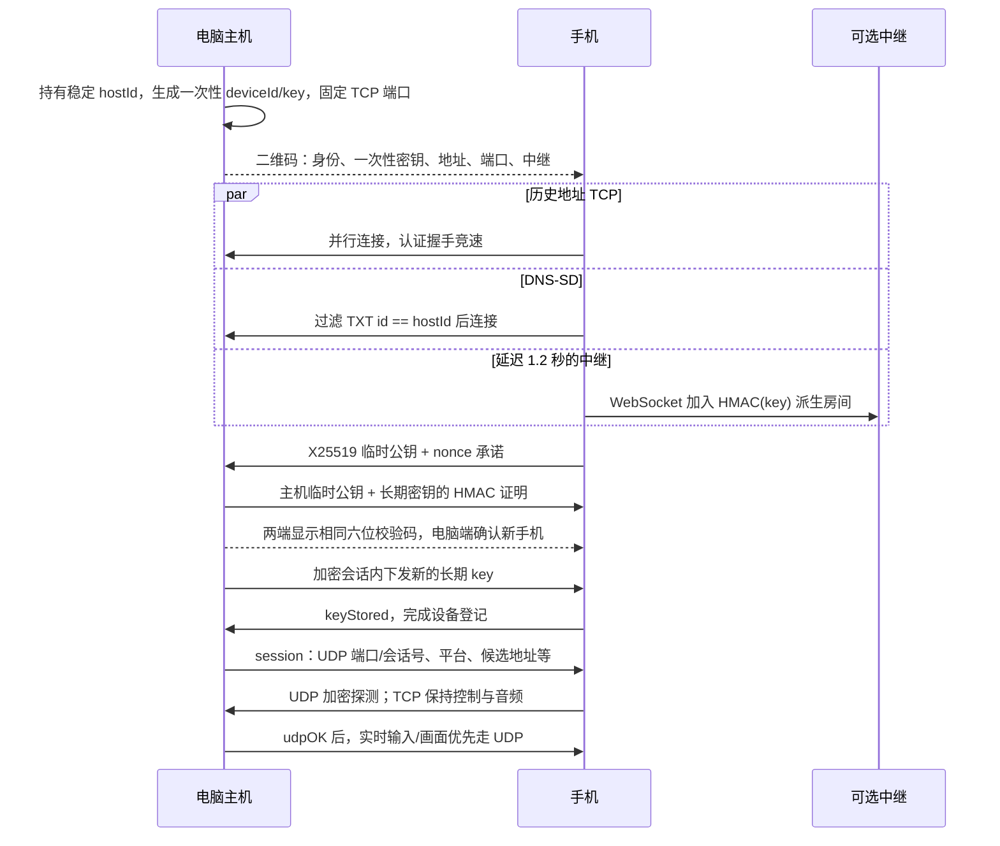

# Blurt 网内快速连接、发现与传输学习（网关约定）

> 研究对象：[AGIHunt/blurt](https://github.com/AGIHunt/blurt)，固定到提交 [`6d9eb4da63f6bbad57d285a666f2ce514d3ced19`](https://github.com/AGIHunt/blurt/tree/6d9eb4da63f6bbad57d285a666f2ce514d3ced19)（2026-11-12）。重点阅读 Swift 参考实现、Rust 主机和 Android 客户端，并对照本仓库当前 Go 网关及原生壳。本文是学习结论与改造建议，不表示这些建议已经实现。

## 结论摘要

Blurt 的“快”来自一组相互衔接的约定，而非某个单点优化：

1. **身份与地址分离**：长期保存 `hostId + deviceId + 长期密钥 + 历史地址 + 端口`，IP 变化不等于换了一台电脑。
2. **发现与连接并行**：历史地址和 Bonjour/DNS-SD 同时尝试，第一个完成认证握手者获胜；公网中继延迟 1.2 秒加入，局域网恢复后重新抢占。
3. **二维码只是启动引导**：码中含一次性 256 位密钥和当前地址；所有网络都要求电脑端确认，随后在加密会话内轮换为长期密钥。
4. **传输按语义分层**：TCP 承担可靠、有序的控制与音频；UDP 承担“迟到就没价值”的指针、光标、视频和修复反馈，探测失败可回退 TCP。
5. **不排队陈旧操作**：断线期间的按键直接丢弃；视频发送受背压与码率控制，弱网用 NACK、LTR 刷新和按需 FEC 修复，而不是反复发送大关键帧。
6. **安全边界贯穿全程**：X25519 临时密钥 + HKDF + ChaCha20-Poly1305 保护局域网、直连和中继；中继只见密文，mDNS 只负责找地址，不代表可信。

对 Mobile Bridge 最有价值的是第 1、2、6 项以及“实时数据不阻塞可靠控制”的思想。现有 HTTP/SSE、增量游标、幂等提交和公网写入约定已经适合聊天网关，**不应为了模仿 Blurt 而改成 UDP 或另建一套业务协议**。

## 1. 端到端连接时序

首次配对的实际顺序如下；之后的自动重连复用已保存的长期设备记录，不再扫码或人工确认。



关键点是**TCP 连接成功并不等于会话可用**：手机先验证主机证明，首个加密帧还要再次核对当时使用的密钥仍然有效；业务消息只在会话问候完成后接受。

## 2. 发现：稳定身份、历史地址与 DNS-SD 并发竞速

### 2.1 二维码同时解决“我是谁”和“现在怎么找到我”

配对链接为：

```text
blurtremote://pair?v=1&mac=<hostId>&id=<deviceId>&k=<一次性key>&n=<名称>&p=<TCP端口>&a=<地址列表>&r=<可选中继>
```

- `mac` 是稳定主机身份，电脑改名、换 IP 后仍能匹配；`id` 是本次配对设备标识。
- `a` 让手机不等 Bonjour 就能直连；`p` 尽量跨重启保持不变，避免历史记录迅速失效。
- `r` 允许不在同一网络时完成配对，但仍须电脑端确认。
- 手机把主机记录持久化；后续连接不再依赖二维码中的旧地址一定有效。

### 2.2 DNS-SD 只做候选发现，不做信任背书

- 服务类型为 `_blurt-remote._tcp`，实例名是电脑名，TXT 记录携带 `id=<hostId>`；端口由服务记录提供。
- 手机同时尝试保存的每个 `host:port` 与浏览到的匹配端点，按 `hostId` 过滤，不对整个网段发扫描。
- iOS 使用 `NWBrowser`，并启用 peer-to-peer Wi-Fi，因此没有共同路由器时也可能直连；Android 使用系统 `NsdManager`，Android 14+ 可一次解析多个地址，旧版串行 resolve。
- Rust 主机枚举地址时排除回环、链路本地和常见虚拟网卡，私网 IPv4 优先；这只是减少无效候选，最终仍以认证结果为准。
- 没有已配对手机且未展示配对码时，主机不监听、不广播；减少攻击面，也避免仅打开设置页就触发本地网络权限提示。

这套机制的本质是**“缓存地址提供速度，DNS-SD 提供自愈，稳定 ID 防止误连”**。DNS-SD 本身可被局域网内其他设备伪造，不能据此发送长期凭据或认定主机可信。

## 3. 配对与建连：先证明身份，再开放会话

### 3.1 一次性配对密钥，不当长期身份使用

- 配对码有效期 120 秒，临近到期时轮换，并留短暂重叠避免扫码边界失败；最多接受 8 次握手尝试。
- 新手机在局域网和中继路径都必须由电脑用户明确允许；一次只允许一个新手机等待确认。
- 两端六位校验码来自握手 transcript 与手机 nonce。手机先在握手明文中提交 nonce 的 SHA-256 承诺，再在首个加密 `hello` 中揭示 nonce；主机验证承诺一致后才展示确认问题，降低中间人选择校验值的风险。
- 确认后主机在已加密会话内发送全新的 256 位长期密钥，手机保存并回应 `keyStored` 后才登记成功。旧二维码照片因此不能再次配对。

### 3.2 每次会话都有前向保密与双向证明

1. 手机发送 `v/id/eph/c`，其中 `eph` 是临时 X25519 公钥。
2. 主机按 `id` 找配对密钥，返回自己的临时公钥和 `HMAC-SHA256(pairedKey, "mac" ∥ transcript)`。
3. 双方从 X25519 共享秘密派生会话密钥：HKDF-SHA256 的 salt 是配对密钥，info 是包含设备 ID 与双方临时公钥的 transcript；收发方向各 32 字节。
4. 数据使用 ChaCha20-Poly1305。TCP 隐式递增计数器作 nonce；UDP 显式携带会话号与计数器，并用 64 宽窗口拒绝重放。
5. 首个加密帧到达时再次检查密钥未因配对码轮换、设备移除或重新配对而失效，避免“旧握手延迟数小时后变成有效会话”。

资源限制也属于协议：握手前帧最大 1 KiB，首个有效加密帧后才放宽到 1 MiB；本地并发握手最多 16 个、6 秒超时，拒绝后立即关闭。未配对者只能到达握手，不能调用输入、麦克风或画面接口。

## 4. 传输：可靠控制流与低延迟数据报分流

### 4.1 一条可靠流，一条可丢弃的数据报路径

| 数据 | 首选路径 | 原因 |
| --- | --- | --- |
| 握手、JSON 控制、按键、命令 | TCP；中继时 WebSocket Binary | 有序、可靠，不能因丢包改变语义 |
| 手机麦克风 PCM16 16 kHz mono | TCP；中继时 WebSocket | 音频识别需要连续字节流 |
| 指针移动、滚动、视频分片、光标、修复反馈 | UDP 探测成功后优先；可回退 TCP/WS | 高频且有时效，旧数据排队反而增加延迟 |
| 跨网络控制面 | 保持中继 WebSocket | UDP 打洞只迁移实时数据，减少控制面切换风险 |

TCP 帧采用 `u32 BE length ∥ frame`，首字节 kind 区分 0 控制、1 音频、2 指针、3 视频、4 探测、5 光标、6 视频反馈。UDP 另带 `u32 session ∥ u64 counter`，同一加密协议覆盖所有路径。TCP 开启 `TCP_NODELAY`，避免小控制包等待合并。

### 4.2 UDP 不是假设可用，而是探测后升级

- 局域网会话的 `session` 消息告诉手机 UDP 端口和随机会话号；手机复用已认证 TCP 对端 IP，发送加密 `scrollStop` 探测。
- 主机只接受当前会话号且能通过 AEAD 验证与重放检查的数据报；以来源地址作为回包路径，并通过 TCP 返回 `udpOK`。
- 局域网探测失败时，指针仍可在 TCP 中发送；中继没有 UDP 时，视频和光标也可回到 WebSocket，但受严格背压。
- 跨网络时先建立中继控制面，再在加密会话内交换 LAN、公共 IPv6 和 STUN 映射候选，从同一 UDP 端口互相打洞；首个验证通过的路径获胜。对称 NAT/CGNAT 失败就保留中继。

因此它不是“用 UDP 替代 TCP”，而是**先用可靠通道协商身份与参数，再把适合丢弃的流量升级到数据报**。

## 5. 实时性与弱网处理为什么有效

### 5.1 控制与媒体分别治理

- 断线期间的按键不排队，避免恢复后补发危险的 ⌘W；按住说话是例外，仅在手指仍按住时于恢复后继续。
- 指针在中继上合并到 30 Hz，本地保持更高频率；光标位置独立于视频传输，手机先按本地输入绘制，再按序号接受已覆盖全部输入的主机位置，避免旧回包把光标拉回。
- 主机 2 秒没听到会话就释放所有按住的键、鼠标键和听写键，12 秒判定会话消失，防止断网造成“卡键”。

### 5.2 视频优化主要解决“出错后的恢复”

- HEVC/H.264 低延迟编码，无 B 帧；局域网/UDP 直连的视频负载切成 1,180 字节分片，降低单包超过常见 MTU 的概率；中继流则整帧发送以控制消息开销。
- **NACK**：主机保留最近 1 秒、最多 6 MiB 的分片，手机按帧号/片号请求重传；重发有带宽预算。低 RTT 的局域网优先 NACK。
- **LTR refresh**：帧彻底丢失时，从手机已确认的长期参考帧生成小恢复帧，而非发送整幅关键帧；不支持时仍回退关键帧。
- **FEC**：高 RTT 且丢包达到阈值时，按交错分组发送 XOR 奇偶片，单组可恢复一个丢失片；局域网低丢包不常开，避免固定带宽税。
- **背压**：中继流中待写视频达到阈值就跳帧；领先手机约 1.5 秒数据量即停发，防止键盘输入排在视频后面。
- **码率**：依据手机每秒上报的收帧、丢帧、RTT、实际接收字节调整；故障时快降，平稳时慢升。每帧至少约 30 kbit，带宽不足优先降帧率保住文字清晰度。
- **无线队列**：实时输入使用 VO 服务类别，视频使用 VI/AF41；这是减少排队，不是保证所有路由器都会执行 QoS。

上游在其模拟丢包测试中，1% 分片突发丢失从修复前 24–34 fps、1.3–1.6 秒冻结，改善到约 59 fps、最长 46–57 ms 间隔。该数字来自模拟器/loopback 加人工坏网，不应直接当作真实 Wi-Fi 承诺。

## 6. 自动重连与线路切换

Blurt 把重连视为持续状态机，而非一次性“连接按钮”：

- App 打开、回前台、解锁后立即重连；连接中的代次编号使旧回调不能覆盖新主机或新会话。
- 本地历史地址与 DNS-SD 每轮同时竞速，TCP 连接超时 3 秒，每 3 秒开始新一轮；8 秒后仍无结果才显示不可达，但后台继续尝试。
- 中继延迟 1.2 秒加入，避免同网时无意义地绕远路；中继尝试间隔至少 4 秒，并给较慢路径约 9 秒完成机会。
- 本地 ping 每 0.5 秒调度，2.5 秒无 pong 判定丢失；中继考虑成本，每四次才实际 ping 一次，8 秒无 pong 判定丢失。
- 已走中继时，每约 10 秒重新尝试局域网。若本地认证会话稍后成功，会主动替换中继；其他迟到连接则关闭。
- 中继 UDP 直连路径每 2 秒探测，6 秒无回包退回中继，15 秒后再次寻找直连；主机侧 7 秒未从该 UDP flow 收到数据也退回流式发送。
- 被另一台手机接管时进入 `replaced`，不反复互相抢会话，等用户触碰后再接管。

可借鉴的不是所有数值，而是**立即尝试、短超时、有界并发、指数/间隔重试、代次隔离、局域网优先、失败可回退**这一整组策略。数值应按手机聊天场景的延迟与流量成本重新测量。

## 7. 对照 Mobile Bridge 现有网关约定

本项目并非从零开始，现有源码已经有不少同构能力：

| 约定 | Blurt | Mobile Bridge 当前实现 |
| --- | --- | --- |
| 稳定主机身份 | 持久 `hostId` | `Auth.DeviceID()` 从持久 Cookie namespace 派生，跨重启稳定 |
| 运行实例身份 | 不用于长期发现 | `instanceId` 每次启动随机生成，适合防止串到旧进程，不适合单独充当长期主机 ID |
| 候选来源 | 配对码历史地址 + DNS-SD + 中继 | 已登录 `/api/auth` 返回 `nativeDirect`；`mobileRoutes` 返回已发布入口 |
| 候选竞速 | 地址与 Bonjour 同时，认证完成者获胜 | Android `EndpointSelector` 最多 4 路并发、3 秒总窗口，首个验证通过者获胜 |
| 所有权证明 | 配对密钥证明 + 会话加密 | `/api/connection/prove` 以挑战-响应 HMAC 证明指定 origin 的持有权 |
| 凭据作用域 | 每设备长期 key | 根会话及按 origin 派生的 `cmbroute1_` 路由 Cookie，绑定目标地址 |
| 网内业务传输 | TCP 控制 + UDP 实时 | HTTP GET/HEAD、附件和 SSE 局域网读取；POST/PATCH/DELETE 保持公网 |
| 增量同步 | 私有帧协议 | SSE `since` 游标或长轮询，断线续读；写操作有持久幂等 ID，不跨链路自动重放 |
| 网内机密性 | 应用层端到端加密 | Android 原生模式是可信热点 HTTP + 已认证 Cookie；浏览器可配置受信 HTTPS 直连 |
| 主动发现 | mDNS/DNS-SD | 当前 Android 明确“不扫描网段、不推断地址”，尚无 DNS-SD 广播/浏览 |

因此，最短路径不是移植 Blurt 协议，而是给现有 `mobileRoutes/nativeDirect + prove + route cookie + firstVerified` 增加 DNS-SD 候选来源。聊天数据无需 UDP；当前“读取可切 LAN、写入留公网”的约定还能避免跨链路重复发送，应该保留。

## 8. 对本项目的落地建议

按投入与安全风险排序，建议如下。

**P0：先补“发现”，不改业务传输。**

1. 网关在 LAN 开启时广播 DNS-SD；Android/iOS 原生壳浏览服务，按持久 `DeviceID` 过滤，合并历史候选、`nativeDirect` 与 mDNS 候选后统一竞速。
2. 候选验证必须复用稳定 `DeviceID` 与现有 challenge/proof，而不是只看 IP、电脑名或每次重启变化的 `instanceId`。
3. 验证成功后沿用现有 HTTP/SSE 与“读 LAN、写公网”策略，保持 Host/Origin/CSRF、附件真实路径和提交幂等规则不变。

**P1：把竞速做成可取消的连接状态机。**

- 回前台和网络变更立即触发；历史地址与 DNS-SD 不互相等待，首个**验证成功**者获胜，而不是首个 TCP 建连者获胜。
- 保存最近成功 origin，下一次优先但不串行阻塞；旧任务通过 generation 取消，迟到回包不得覆盖新选择。
- 公网仍可用时后台探测 LAN；LAN 失效只重放安全的 GET/HEAD/SSE，写请求继续遵循“结果未知不自动跨链路重放”。

**P2：再改善引导与可观测性。**

- 若未来需要扫码引导，应设计新的短期、单次、源绑定配对流程，并明确桌面签发入口；不要把已退役的旧 `/api/pair` 当成现成能力直接恢复。
- 记录候选来源、DNS-SD 解析耗时、proof 耗时、首个可用路由耗时、回退原因与 SSE 重连次数，用真机数据再调超时，而不是照搬 Blurt 的毫秒数。
- 真机覆盖同 Wi-Fi、手机热点、换 DHCP 地址、网关重启、路由不可达、mDNS 被系统禁用和伪造同名服务。

## 9. 建议的 DNS-SD 与候选验证约定

建议把新增发现限定为以下最小契约，避免扩大 HTTP 攻击面：

```text
service: _mobile-bridge._tcp
instance: <用户可读的电脑名>
TXT: v=1, id=<Auth.DeviceID() 的 32 位小写 hex>
port: 现有 HTTP LAN 监听端口
```

- 仅在 `lan=true` 且对应监听器已启动时广播；监听器停止或配置排除全部 LAN 地址时撤销。多网卡广播同一稳定 ID，不把虚拟网卡地址作为优先候选。
- TXT 不放账号、Cookie、配对密钥、Tunnel Token 或固定域名凭据。实例名和 DeviceID 的局域网可见性应写入隐私说明。
- 客户端把解析结果规范化为无路径、无 userinfo 的 origin，只接受当前支持的 LAN HTTP 或受信 HTTPS；每个 origin 去重并限制数量，按 ID 过滤，不网段扫描。
- **mDNS 结果一律不可信**。先调用现有 `/api/connection/prove` 完成匿名挑战-响应，再按 `mobileRoutes` 的绑定/续期流程取得该 origin 的路由级凭据；最后才允许发送业务请求。
- 不应把未经验证的 mDNS 候选直接交给当前 Android `DirectTransport.verify()`：该函数会携带公网 Cookie 请求 `/api/auth`，直接复用会把凭据发给伪造端点。
- 已验证后仍核对 `authenticated`、稳定 `DeviceID` 和当前 `instanceId`。前者证明设备与会话，后两者分别防止同名/旧地址误连和连接到非本次运行实例。
- 若当前会话不具备 trusted-device/路由续期能力，则保留公网或现有 `nativeDirect` 路径，不降级为“IP 可达即信任”。

这样新增的只是候选来源，现有 HTTP 路由、认证、授权和业务数据格式都无需变化。

## 10. 不应照搬的部分

- **不把聊天消息、审批、Goal 操作迁到 UDP。** 这些操作要求可靠顺序、授权与幂等，现有 HTTP 契约更合适。
- **不引入 Blurt 的视频编解码、LTR/FEC 和远控输入协议。** 它们服务于桌面镜像与遥控，不是聊天网关的必要成本。
- **不把“中继只转发密文”误当成可省略 HTTPS。** Blurt 有应用层 AEAD；Mobile Bridge 当前 HTTP 没有这一层，公网仍须 TLS。
- **不把二维码里的密钥当长期密码。** 若未来新增扫码，短期兑换、电脑确认、撤销与轮换必须同时设计。
- **不让发现绕过认证。** 服务可见、端口可连、instanceId 匹配各自都不够，必须有持有权证明和有效会话。
- **不自动重放写请求。** Blurt 可丢弃断线时的按键，但聊天提交不能简单丢弃或重复；继续使用现有提交账本和人工确认。
- **不为了发现常开额外管理接口。** DNS-SD 指向现有 LAN HTTP 监听即可，网关启停与网络配置仍只由本机管理。

## 11. 验证与证据边界

本次已完成：

- 固定上游提交并直接阅读发现、配对、加密、客户端竞速、TCP/UDP 通道、中继、视频修复与码率控制源码。
- 对照本仓库 `internal/auth`、`internal/httpd`、Android 直连选择器、iOS 路由发现及共享信道脚本。
- 在 macOS 上执行 `cargo test --manifest-path .tmp/blurt/crates/blurt-remote/Cargo.toml --lib`：**153 passed，0 failed**。

证据边界：

- 测试通过证明所读提交的协议与状态机自洽，不等于 Mobile Bridge 新增发现功能已经实现或验证。
- 上游 `remote-realtime.md` 明确说明其最新实时视频数据主要来自模拟器/loopback 与人工坏网，真实 iPhone Wi-Fi、120 Hz、部分硬件解码和 Windows/Linux 实机仍有未验证项。
- 本次未进行 Blurt 或 Mobile Bridge 的真机网络测试，未修改网关或原生客户端代码，也不需要重启网关。

## 12. 源码索引

上游（均固定到本次提交）：

- [协议分层、握手、DNS-SD、配对链接与视频修复格式](https://github.com/AGIHunt/blurt/blob/6d9eb4da63f6bbad57d285a666f2ce514d3ced19/docs/design/remote-protocol.md)
- [连接、重连、中继、安全及实测说明](https://github.com/AGIHunt/blurt/blob/6d9eb4da63f6bbad57d285a666f2ce514d3ced19/docs/design/remote.md)
- [NACK/LTR/FEC、背压、码率与证据边界](https://github.com/AGIHunt/blurt/blob/6d9eb4da63f6bbad57d285a666f2ce514d3ced19/docs/design/remote-realtime.md)
- [iOS 地址/Bonjour/中继竞速与自动重连](https://github.com/AGIHunt/blurt/blob/6d9eb4da63f6bbad57d285a666f2ce514d3ced19/apps/ios/BlurtRemote/Net/Link.swift)
- [iOS TCP/UDP 通道、探测和直连保持](https://github.com/AGIHunt/blurt/blob/6d9eb4da63f6bbad57d285a666f2ce514d3ced19/skills/blurt/recorder/macos/Sources/BlurtRemoteKit/RemoteChannel.swift)
- [Android DNS-SD 系统实现](https://github.com/AGIHunt/blurt/blob/6d9eb4da63f6bbad57d285a666f2ce514d3ced19/apps/android/app/src/main/java/dev/blurt/remote/app/net/Discovery.kt)
- [Rust 主机监听、配对、会话与 mDNS 广播](https://github.com/AGIHunt/blurt/blob/6d9eb4da63f6bbad57d285a666f2ce514d3ced19/crates/blurt-remote/src/server.rs)
- [Rust 加密握手与重放窗口](https://github.com/AGIHunt/blurt/blob/6d9eb4da63f6bbad57d285a666f2ce514d3ced19/crates/blurt-remote/src/crypto.rs)

本仓库关键位置：

- `internal/auth/mobile.go:47`：持久 Cookie namespace 与稳定 `DeviceID`。
- `internal/httpd/connection.go:60`：发布候选、路由凭据与匿名 ownership proof。
- `internal/httpd/httpd.go:1537`：`/api/auth` 的 `instanceId`、`mobileRoutes`、`nativeDirect`。
- `cmd/gateway/main.go:1182`：动态 LAN 候选枚举；`cmd/gateway/main.go:417`：每次运行生成 `instanceId`。
- `android/app/src/main/java/com/mobilebridge/app/EndpointSelector.java:18`：有界并发、首个验证成功候选。
- `android/app/src/main/java/com/mobilebridge/app/DirectTransport.java:39`：候选刷新、Cookie 验证、失效回退。
- `mobile/ios/BridgePreview/ConnectionDiscovery.swift:85`：路由派生凭据、proof 与并发探测。
- `mobile/shared/web/channel-link.js:20`：局域网优先与路由切换的页面侧约定。
