# mobile-bridge：项目级运行结构与关键状态

> 范围：当前 Go 网关及网页客户端（2026-11-04）。图示只描述代码中已装配的路径；不同 Agent、平台和入口的能力由运行时门控，图中的并列模块不表示每条会话都支持全部能力。

团队编排的 Run、Task、Action、成员问题及团队恢复细节单独见 [团队编排运行图册](team-runtime-diagrams.md)。本页聚焦网关共享控制面与其他有明确持久状态的子系统。

## 图表索引

1. [网关与外部执行器](#1-网关与外部执行器)
2. [会话读取和发送](#2-会话读取和发送)
3. [普通提交与实时同步](#3-普通提交与实时同步)
4. [Goal 状态与命令账本](#4-goal-状态与命令账本)
5. [Codex 账号切换](#5-codex-账号切换)
6. [ACP 账号池登录](#6-acp-账号池登录)
7. [公网连接状态](#7-公网连接状态)
8. [通知投递](#8-通知投递)
9. [审批与提问回应](#9-审批与提问回应)
10. [会话迁移](#10-会话迁移)

## 1. 网关与外部执行器

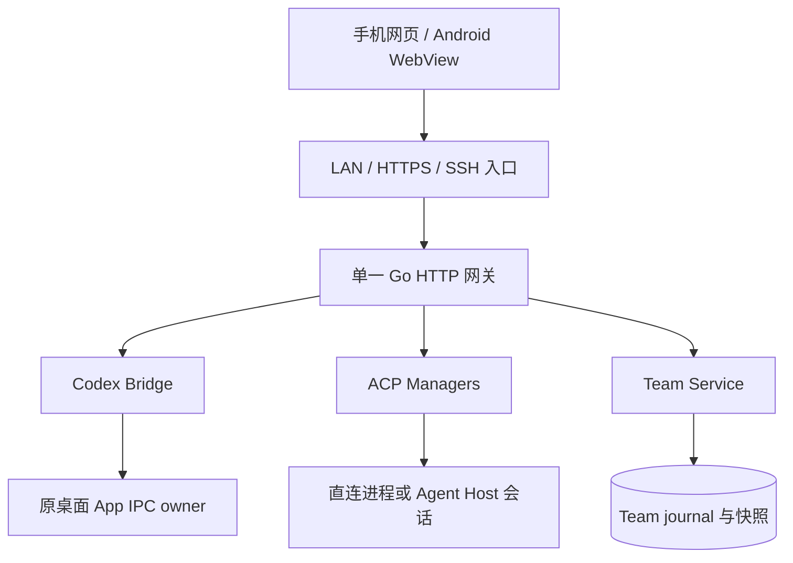

网关内部的共享控制面：

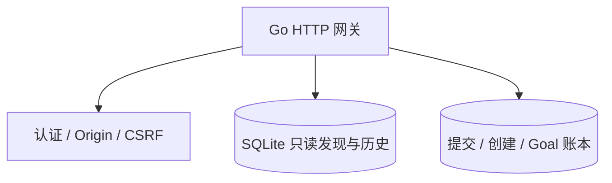

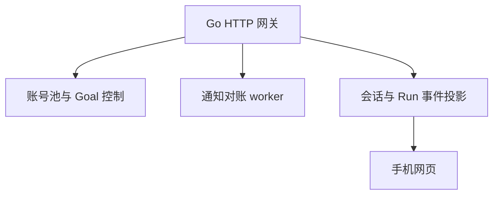

单一 `cmd/gateway` 二进制装配 `internal/httpd`、Codex 原生 IPC、ACP runtime、Team、账号和通知服务。Quick Tunnel 与 SSH 反向转发只提供访问路径，不拥有会话执行；Agent 的原始历史留在各自的原生存储。依据：`cmd/gateway/main.go`、`internal/httpd/httpd.go`、`internal/codex`、`internal/acpruntime`、`internal/team`。

## 2. 会话读取和发送

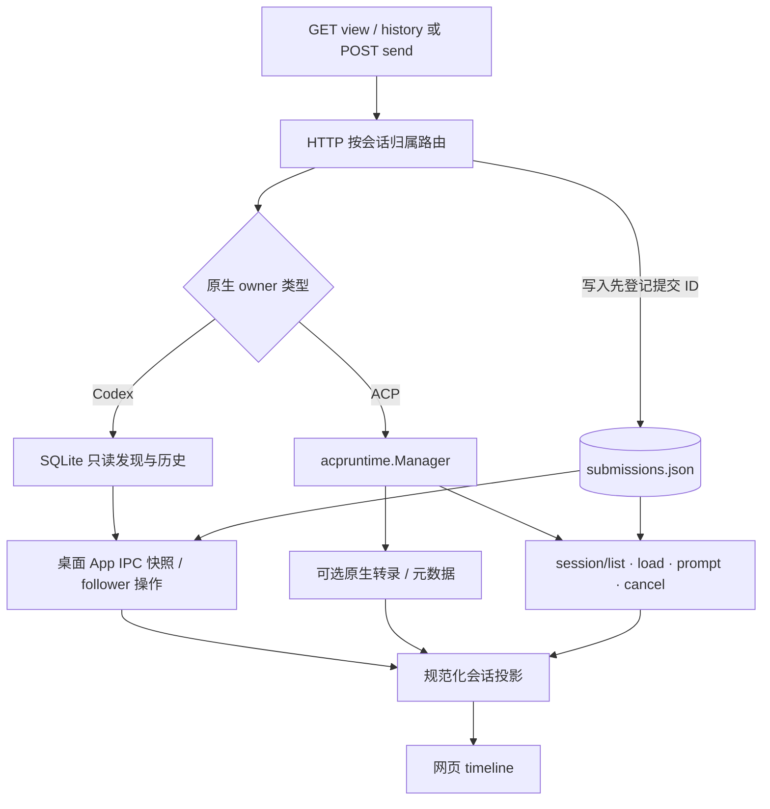

读请求不等于发起模型任务。Codex 写操作要求原桌面 owner，ACP 写操作走所属 Manager；发送结果不确定时保持未知记录，不能换传输链路自动重放。依据：`internal/httpd/sessions.go`、`queue.go`、`internal/codex`、`internal/acpruntime/manager.go`。

## 3. 普通提交与实时同步

普通消息的持久提交状态与团队 Task 使用同一套 `submissions.json` 词汇，状态图见 [提交队列状态](team-runtime-diagrams.md#9-提交队列状态)。队列的 `unknown → queued` 仅限明确未送达的尝试；可能已到达 Agent 的请求保持 `unknown`。

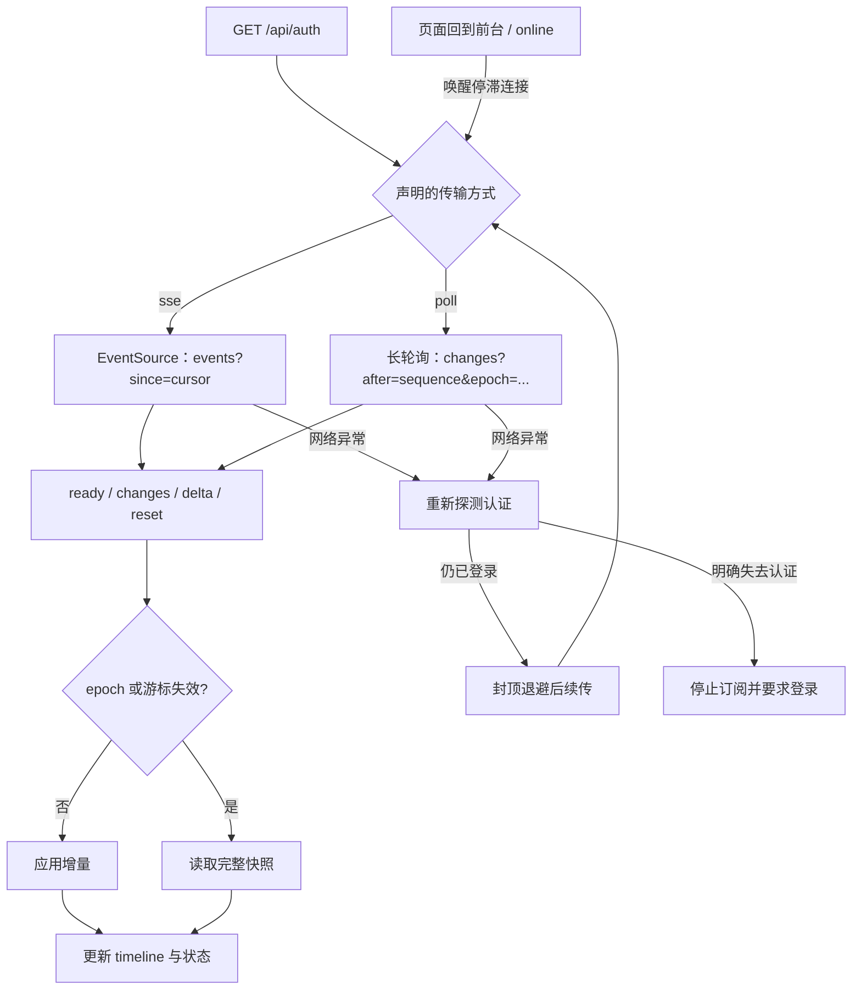

SSE 和长轮询共用事件游标与回调；只有明确的认证失效才退出登录。实时帧不是提交成功证明，写入结果以提交账本与原生会话状态为准。依据：`web/transport.js`、`web/connection.js`、`internal/httpd/changes.go`。

## 4. Goal 状态与命令账本

原生 Goal 状态由 Codex 或声明 `goals` 能力的 ACP Agent 持有；手机的操作记录另存于 `goal-commands.json`。两者不能混成一个状态机。

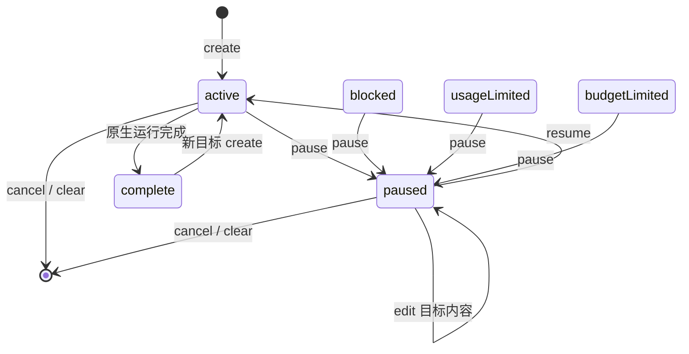

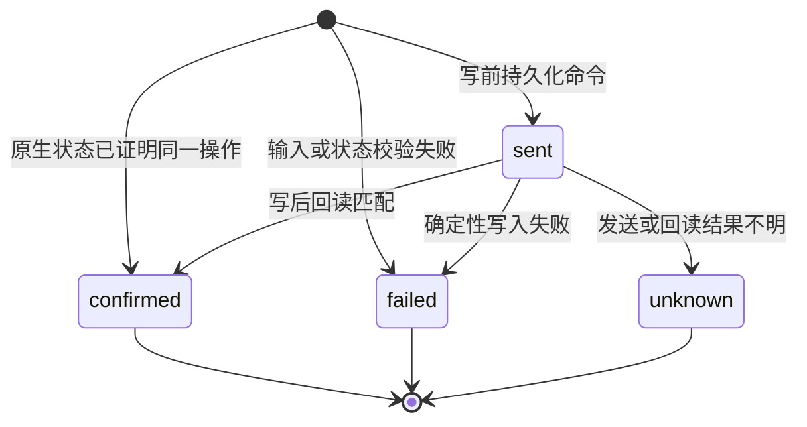

`sent` 若在进程中断后遗留，对同一请求 ID 返回“结果未知”，不会重发写入。原生 Goal 的 `complete` / `blocked` 等由 provider 报告，Go 命令机只允许代码明确列出的转换。依据：`internal/httpd/goal_send.go`、`internal/goal/goal.go`。

命令账本启动时必须成功解析；首次外部写入前先持久占用请求 ID，写盘失败即拒绝操作。确认结果写盘失败会返回错误，但已持久的 `sent` 占用保留，后续按结果未知处理。

## 5. Codex 账号切换

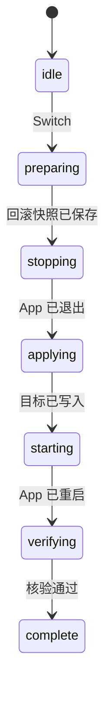

失败与恢复路径：

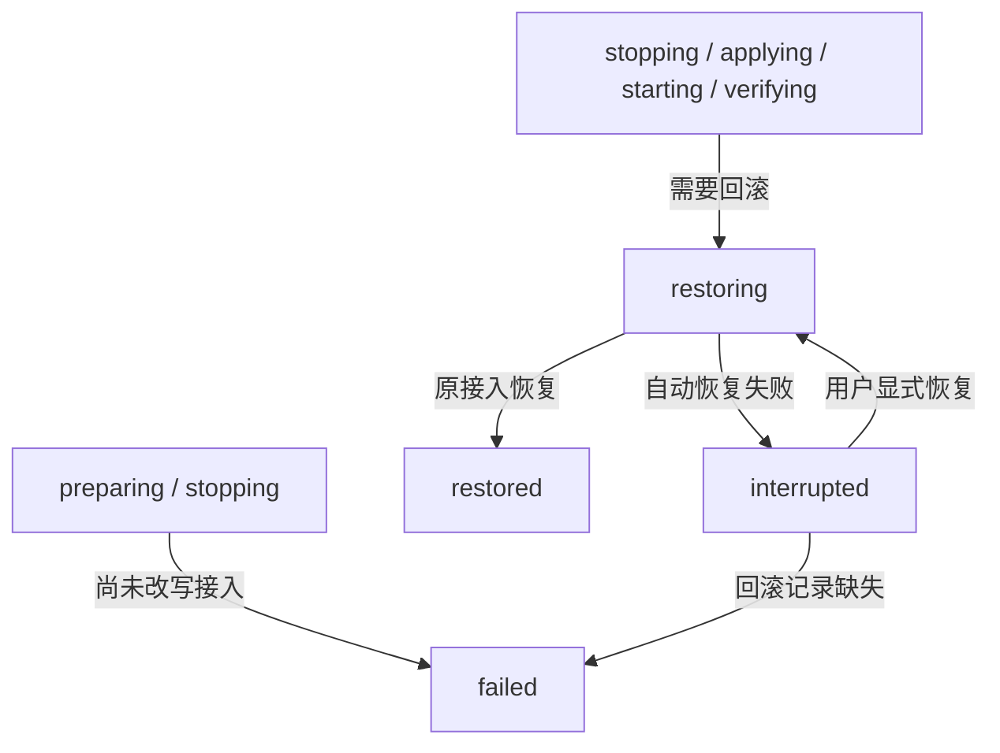

活动 phase 在进程重启后归一为 `interrupted`，阻止继续修改聊天；`complete/failed/restored/idle` 可发起新切换。此图是 Codex 桌面接入切换，不是 ACP 多账号池的槽位切换。依据：`internal/account/switch.go`、`account.go`。

## 6. ACP 账号池登录

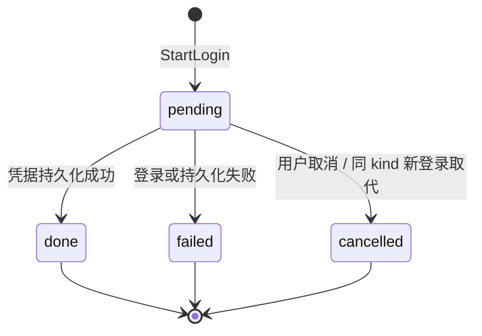

Kimi、ZCode、MiniMax、WorkBuddy 的登录驱动共享此状态机；同 kind 只保留一条在途登录。被取消的旧登录即使迟到完成也不能写入账号池。账号快照另有 `active/reauth_required/disabled/cooling_down` 可用性字段，不等同于登录会话状态。依据：`internal/accpool/login.go`、`pool.go`。

账号快照的常见转换是 `active → reauth_required`（刷新或鉴权失败）以及 `reauth_required → active`（重新登录或刷新成功）。`disabled` 可来自已有账号数据并阻止切换目标；`cooling_down` 是声明的状态值，当前 Go 路径没有为它写入自动迁移，不应把它当作已实现的冷却状态机。

## 7. 公网连接状态

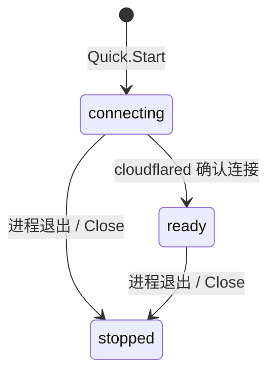

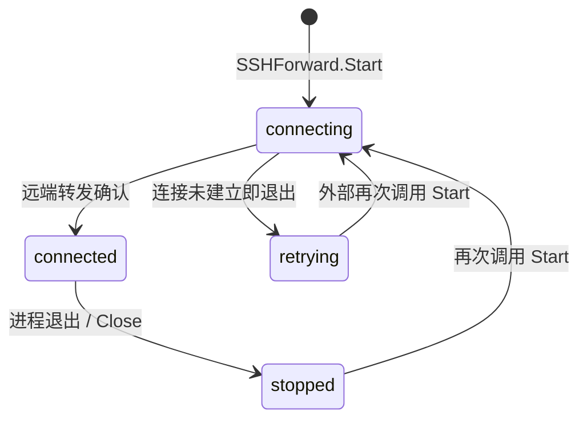

Quick 与 SSH 状态分别写入本地状态文件；状态文件不等于公网端点健康证明。`internal/tunnel` 本身没有在 `retrying` 内执行循环重连，是否重新调用 `Start` 由上层管理。局域网监听不依赖这些进程。依据：`internal/tunnel/quick.go`、`ssh.go`。

## 8. 通知投递

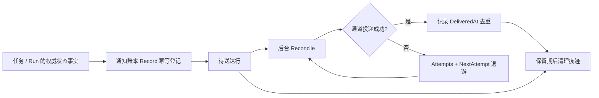

通知发布失败不回滚业务状态。Run 的终态通知已送达后永久按类别去重，`waiting_input` / `stall` 可随同一 Run 后续事件重新登记；启动补发由水位与已送达痕迹限制范围。依据：`internal/notifications/runledger.go`、`outcomes.go`、`cmd/gateway/main.go`。

## 9. 审批与提问回应

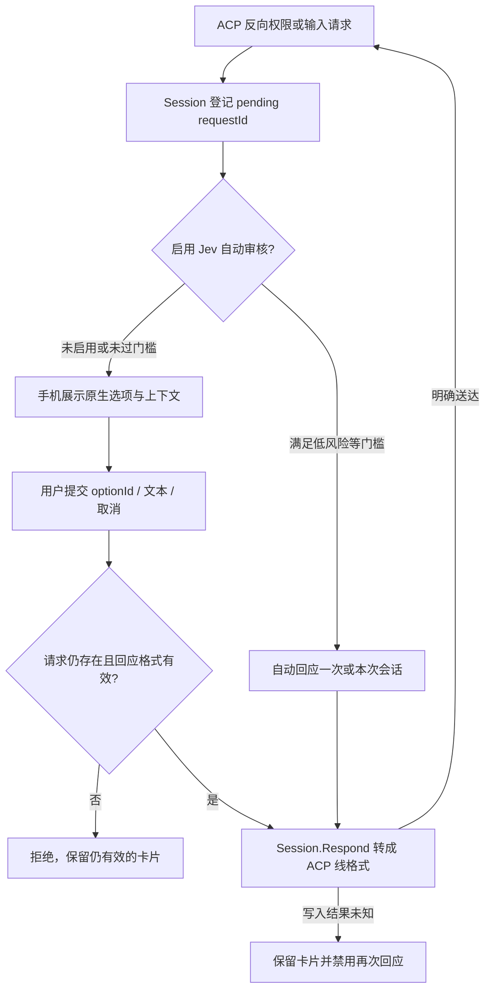

Codex 的回应走桌面 owner IPC，不经过 ACP 的 `Session.Respond`。ACP 写入结果未知时不会再提交回应或在清理阶段补发取消；卡片保留供核实，明确未发送的失败仍可重试。图中的“已提交”不应被解释为 Agent 已执行副作用。依据：`internal/httpd/sessions.go`、`internal/acpruntime/manager.go`、`internal/jev`。

## 10. 会话迁移

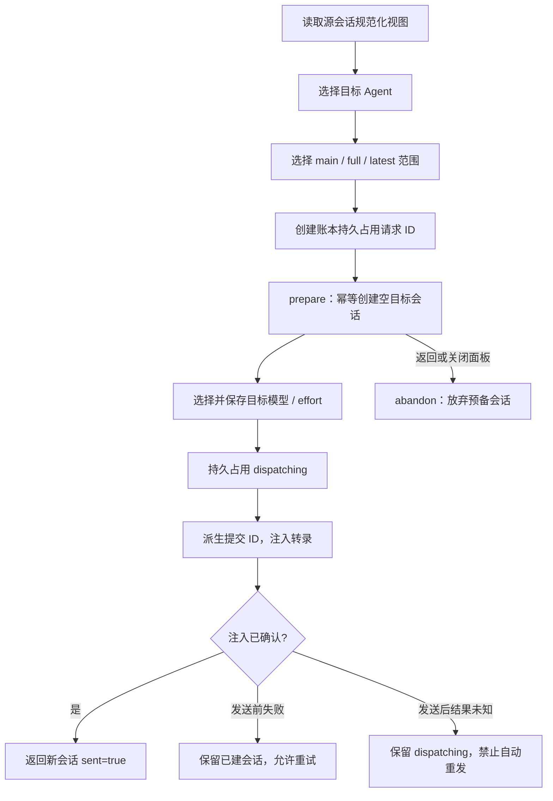

源会话不变。`creations.json` 损坏或不可读时网关拒绝启动；创建占用写盘失败时不调用目标 Agent。目标会话已创建但 ID 写盘失败时保留无 ID 占用并拒绝重建。注入前失败可沿用请求 ID 重试；注入开始后的结果未知须在目标会话核实，不能自动重发。迁移与压缩的目标选择及预备状态见 `internal/httpd/migrate.go`、`creations.go` 和 `web/migrate.js`。
