# 团队编排：运行结构与状态转换图

> 适用范围：当前 Go 网关中的 Team 编排实现（2026-11-04）。图中的实线为已实现路径；规划中的 TeamInput 自动路由、自动 worktree 与成员供给不计入现行状态机。

本页的 Mermaid 图可直接在 GitHub 文档中阅读。[交互式运行时结构图](diagrams/team-runtime.html)提供缩放、查找与导出；[总体产品图](diagrams/mobile-bridge-team.html)描述用户视角，两者与本页的代码级图用途不同。

持久状态机覆盖 Run、Task、Lead Action、PendingQuestion 和 submissions；`VerifyResult`、`PendingTriggerID`、事件游标和 TeamInput 路由是流程/标记，不另造状态枚举。`RunPlanning` / `RunCollecting` 是兼容常量，当前执行流不写入。

## 图表索引

1. [运行时组件](#1-运行时组件)
2. [对象与事实归属](#2-对象与事实归属)
3. [创建与派发流程](#3-创建与派发流程)
4. [重启与运行中对账](#4-重启与运行中对账)
5. [Run 状态](#5-run-状态)
6. [Task 状态](#6-task-状态)
7. [Lead Action 状态](#7-lead-action-状态)
8. [成员问题状态](#8-成员问题状态)
9. [提交队列状态](#9-提交队列状态)
10. [验证闸门与工作区](#10-验证闸门与工作区)
11. [事件投影与页面同步](#11-事件投影与页面同步)
12. [当前 TeamInput 路由](#12-当前-teaminput-路由)
13. [定时触发与通知](#13-定时触发与通知)

## 1. 运行时组件

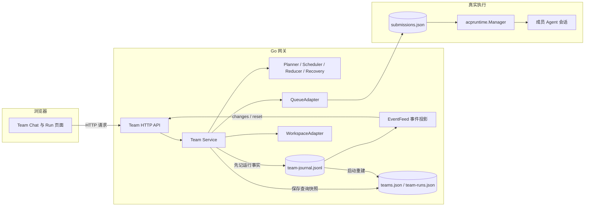

`internal/httpd/teams.go` 负责认证、路由和投影；`internal/team/runner.go` 控制运行；外部 I/O 经 `internal/team/ports.go` 的接口装配。成员会话的完整转录归 Agent runtime，Team 仅保存有界结果与引用。

## 2. 对象与事实归属

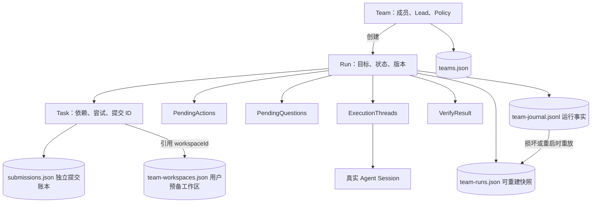

`teams.json` 保存 Team 配置；Run/Task/Action/Question/Thread 的事件事实写入 journal，`team-runs.json` 是可重建的查询快照。提交账本和工作区注册表由 `internal/httpd` 持有，不能把它们当作 Team journal 的一部分。依据：`internal/team/model.go`、`store.go`、`journal.go`、`recovery.go` 与 `cmd/gateway/main.go`。

## 3. 创建与派发流程

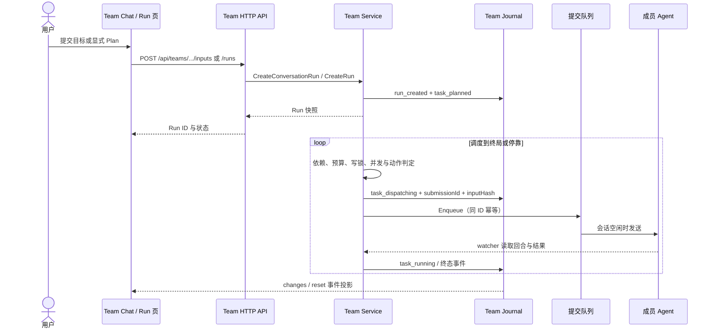

派发先记录事实，再调用队列；队列提交结果不明时不自动重发。完整顺序见 `internal/team/runner.go` 的 `loopPass` / `executeDispatch`、`internal/team/dispatcher.go` 与 `internal/httpd/queue.go`。

## 4. 重启与运行中对账

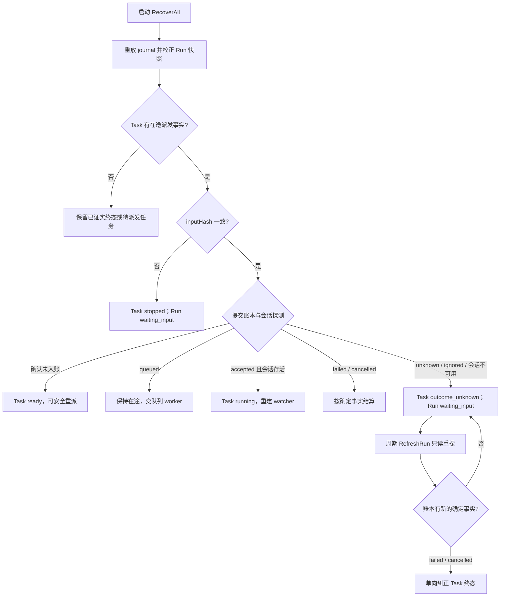

`ReconcileRun` 是启动时按 journal 和提交账本进行的完整对账；`ReconcileUnknown` 只处理运行中已标为 `outcome_unknown` 的 Task，只有账本明确 `failed` / `cancelled` 才纠正，不会把“现在查不到”当成“从未发送”。依据：`internal/team/recovery.go`、`runner.go` 的 `RecoverRun` / `RefreshRun`。

## 5. Run 状态

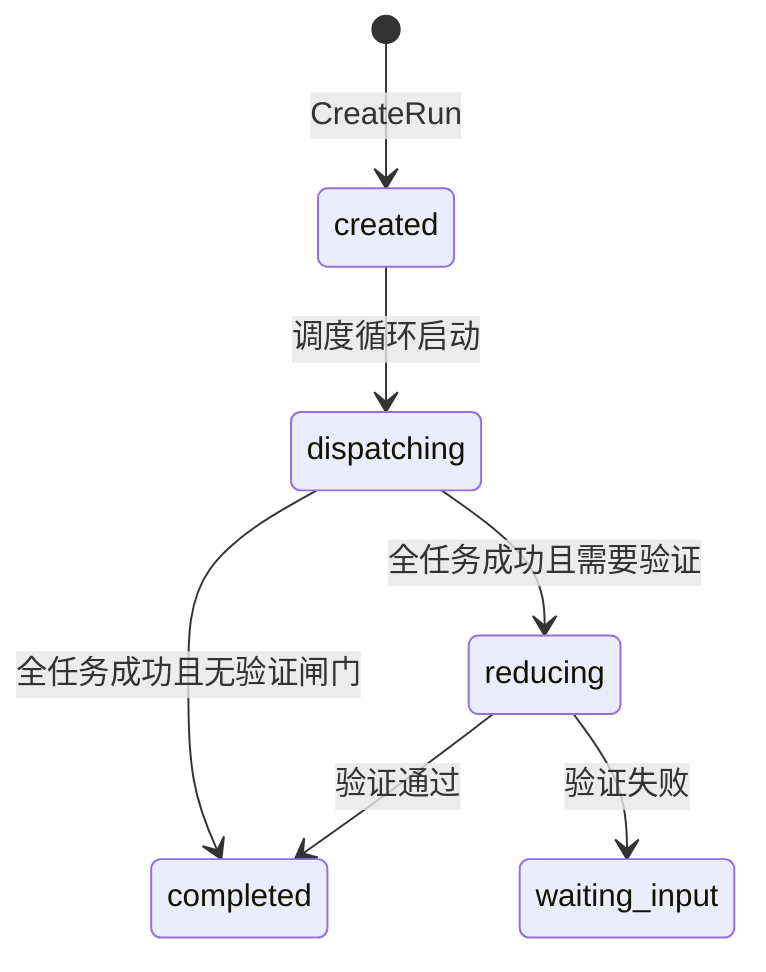

暂停与停靠恢复：

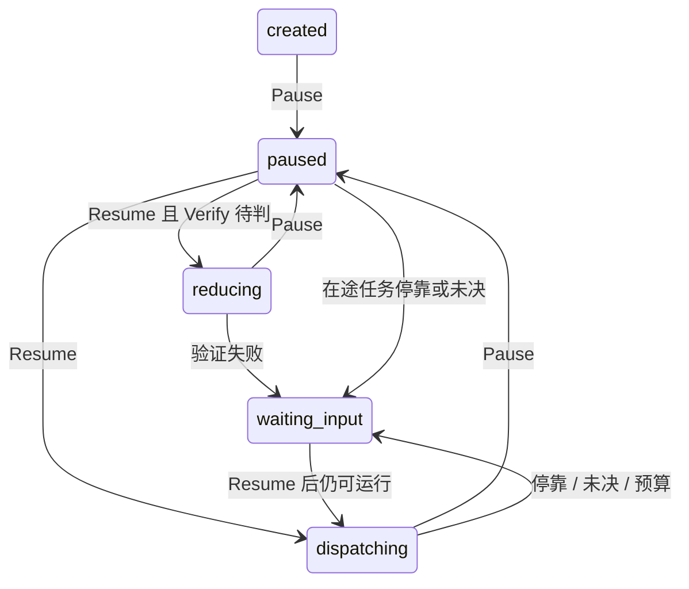

终局折叠与显式取消：

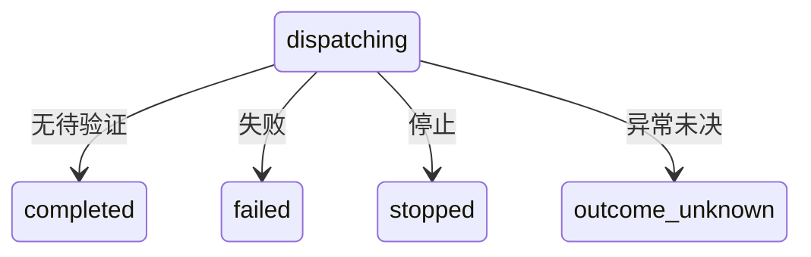

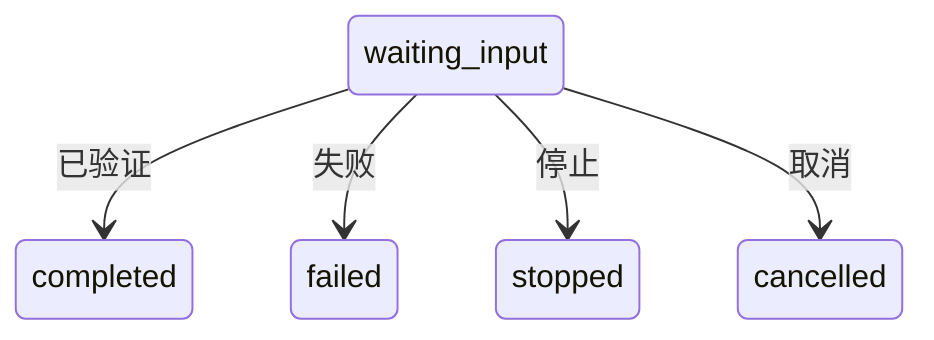

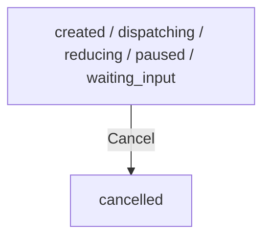

`paused` 和 `waiting_input` 都停止新派发，但在途 watcher 仍可结算；后者的停靠语义优先。图中的 `waiting_input` 终局折叠仅由用户 Resume 触发；全成功但验证未决时先回 `dispatching`，通过验证后才能 `completed`。`planning` / `collecting` 常量仍可读旧数据，当前 runner 不写入这两态。终态 Run 不可重新打开，后续工作创建新 Run / amend。依据：`internal/team/model.go`、`runner.go` 的 `passAdvance` / `passFold` / `Pause` / `Resume` / `Cancel`、`verify.go`。

| 当前状态 | 触发 | 下一状态 |
| --- | --- | --- |
| `created` | 调度 / Pause / Cancel | `dispatching` / `paused` / `cancelled` |
| `dispatching` | 任务折叠 / 验证待执行 / 停靠 / Pause / Cancel | 终态 / `reducing` / `waiting_input` / `paused` / `cancelled` |
| `reducing` | 验证通过 / 失败 / Pause / Cancel | `completed` / `waiting_input` / `paused` / `cancelled` |
| `paused` | Resume / 在途停靠 / Cancel | `dispatching` 或 `reducing` / `waiting_input` / `cancelled` |
| `waiting_input` | Resume / Cancel | `dispatching` 或已满足条件的终态 / `cancelled` |

## 6. Task 状态

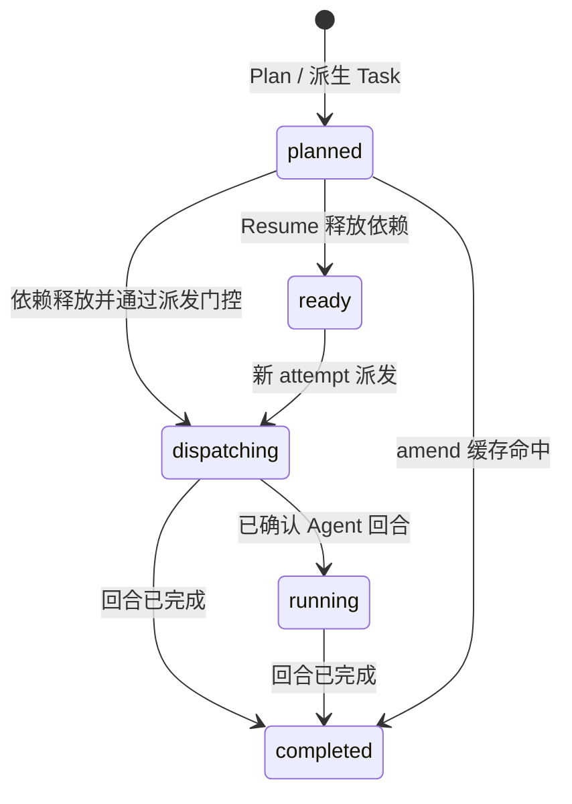

派发前终止：

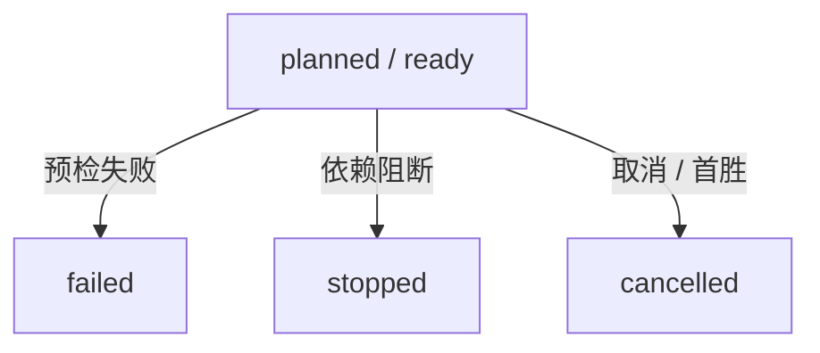

派发后的失败、停靠与取消：

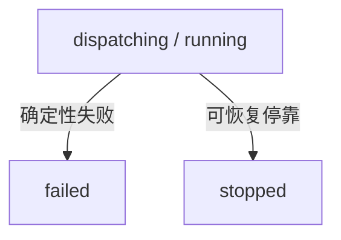

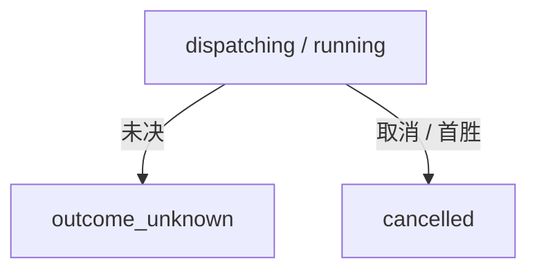

重试与结果未知的裁决：

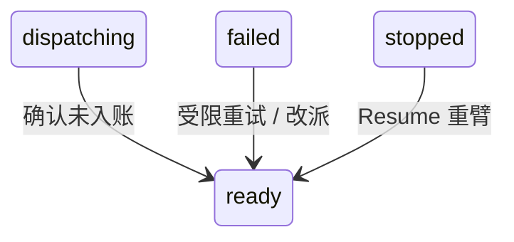

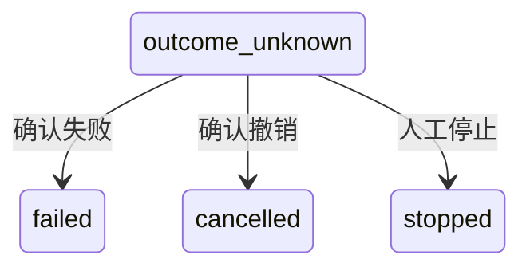

`ready` 主要来自恢复、受限重试或停靠重臂，正常新 Task 可从 `planned` 直接派发。`failed → ready` 与 `stopped → ready` 都必须增加 attempt 并生成新的 submission ID；`outcome_unknown` 不能自动回 `ready`。`task_stopped` 事件的 `payload.status` 区分 `cancelled` / `stopped`，旧事件按固定取消原因兼容。依据：`internal/team/scheduler.go`、`runner.go`、`reducer.go`、`recovery.go`。

恢复时 journal 是权威事实，损坏或滞后的快照可从任意旧状态校正到已记录的终态；这类快照修复由第 4 图描述，不视为正常执行迁移。

| 当前状态 | 触发 | 下一状态 |
| --- | --- | --- |
| `planned` / `ready` | 派发 / 缓存命中 / 预检失败 / 阻断 / 取消 | `dispatching` / `completed` / `failed` / `stopped` / `cancelled` |
| `dispatching` / `running` | 回合结果 / 失败 / 停靠 / 未决 / 取消 | `completed` / `failed` / `stopped` / `outcome_unknown` / `cancelled` |
| `failed` | 限流、暂态受限重试或 Lead 改派 | `ready`（新 attempt） |
| `stopped` | 用户继续且停靠允许重派 | `ready`（新 attempt） |
| `outcome_unknown` | 只读对账或用户确认不再重发 | `failed` / `cancelled` / `stopped` |

## 7. Lead Action 状态

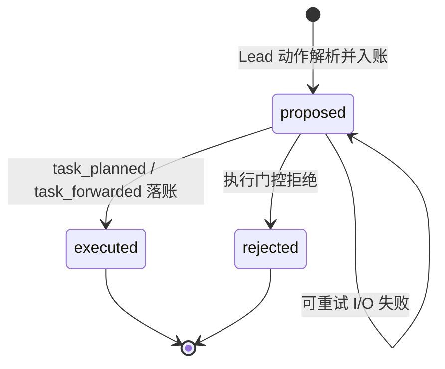

`delegate` / `summarize` 通过派生 Task 记录执行事实，`request_context` 通过转发事件记录。`autoDispatch` 关闭时 `proposed` 仅作预览，可随 Run 终局保留原状态；journal 已落执行事实而快照仍是 `proposed` 时按幂等键收敛，不重复执行。依据：`internal/team/actions.go`、`runner.go` 的 `passActions` / `convergeAction`。

## 8. 成员问题状态

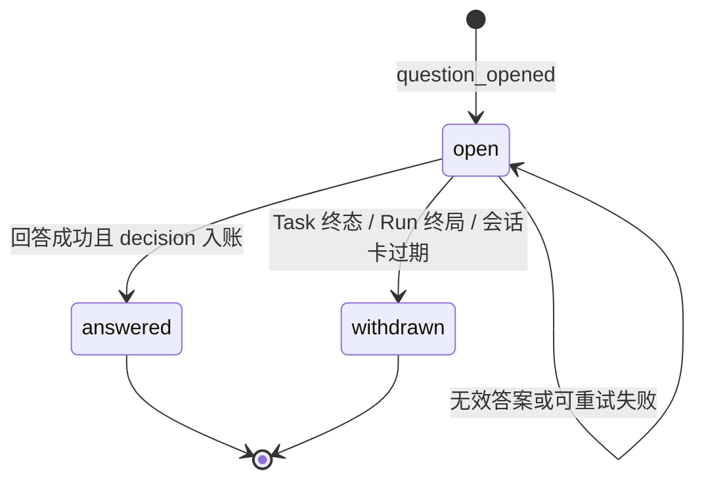

每个 Task 最多登记 3 个 `open` 问题；回答按 `questionId + version` 消费一次。撤回事实为 `question_withdrawn`，原因分别为 `task_terminal`、`run_finished`、`stale`。问题状态属于 Run 的 `pendingQuestions`，不是 Task 自身的 `waiting_input` 状态。依据：`internal/team/questions.go`、`model.go`。

## 9. 提交队列状态

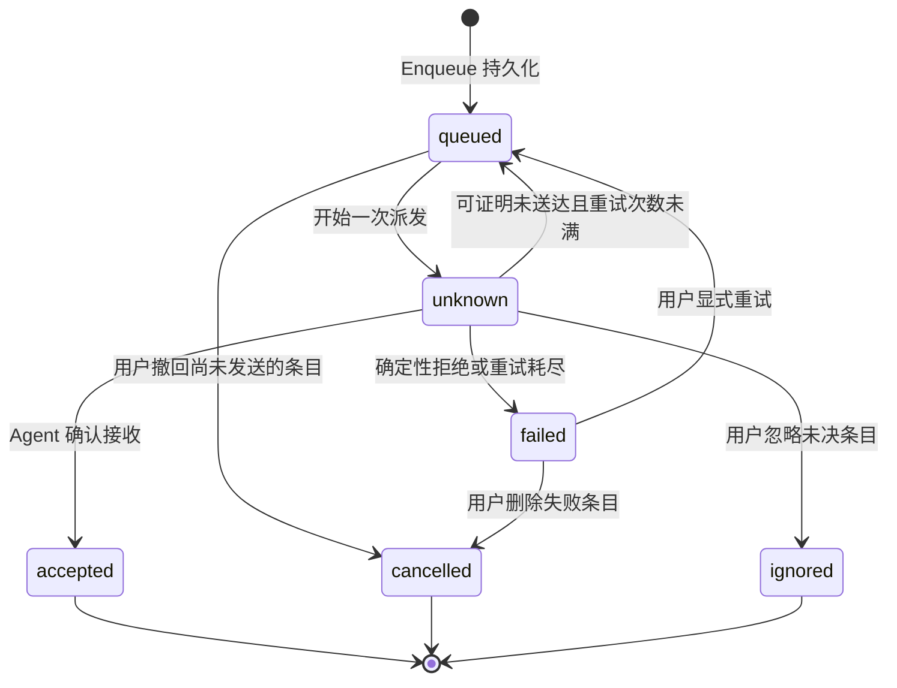

这是 `submissions.json` 的**提交状态**，不是 Task 状态。`unknown → queued` 只发生在发送路径明确判定“未送达”的可安全重排情形，最多 10 次；调用已可能到达 Agent 时保持 `unknown`，Team 对应 Task 进入 `outcome_unknown` 并等待对账。依据：`internal/httpd/queue.go`、`internal/team/ports.go`、`recovery.go`。

## 10. 验证闸门与工作区

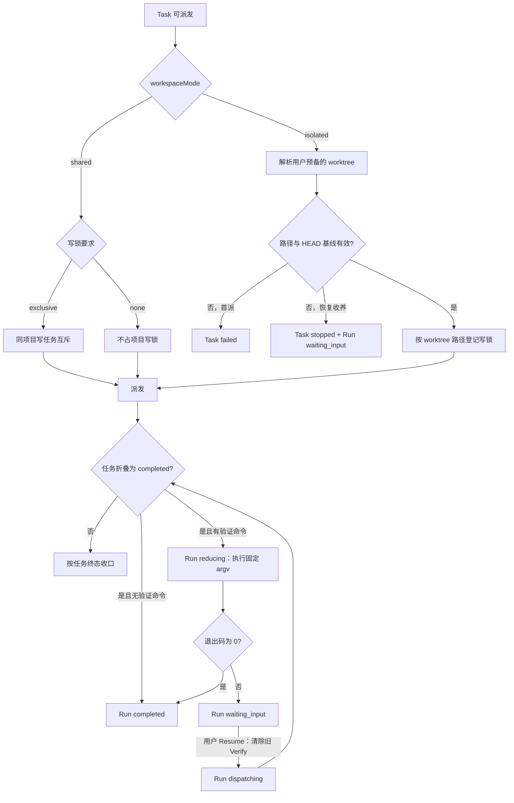

工作区注册表只引用用户已准备的 worktree；网关不自动创建或合并。验证结果写入 `Run.Verify` 与 `run_verify` 事件，失败后允许用户修复再复验。依据：`internal/team/scheduler.go`、`runner.go`、`verify.go`、`internal/httpd/teams_workspace.go`。

## 11. 事件投影与页面同步

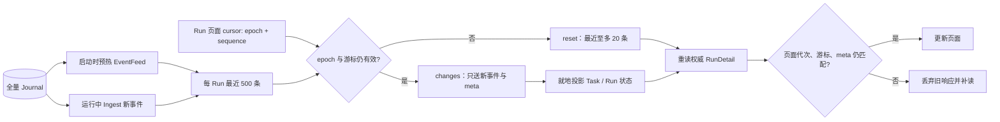

`sequence` 取全局 journal 序号，单 Run 内允许空洞；重启生成新 `epoch`，旧游标走 `reset`。页面关闭后代次改变，晚到读取不能重新订阅；详情补读也不能覆盖更新的事件或 meta。依据：`internal/team/projection.go`、`internal/httpd/teams.go`、`web/team.js`。

## 12. 当前 TeamInput 路由

```mermaid
flowchart TD
    Chat[Lead 会话发送 teamMode=team] --> Validate[校验目标、附件与 inputId]
    Input[POST /api/teams/:id/inputs] --> Validate
    Validate --> Existing{同 inputId 的 Run 或任务已存在?}
    Existing -- 同内容 --> Duplicate[返回原 Run + duplicate]
    Existing -- 不同内容 --> Conflict[拒绝复用 ID]
    Existing -- 否 --> Active{恰有一个活跃 autoPlan Run?}
    Active -- 是 --> Append[追加 Lead Task 到原 Run]
    Active -- 多个 --> Conflict
    Active -- 无且有终态 --> Amend[从最近终态 Run 创建 parentRunId 修订]
    Active -- 无任何 Run --> Create[创建初始 single + autoPlan Run]
    Append --> Route[routeStatus = new_task]
    Amend --> Route
    Create --> Route
    Direct[teamMode=direct] --> Normal[普通会话发送链路]
    Plan[POST /api/teams/:id/runs] --> Explicit[显式 Plan Run]
```

`inputId` 是消息幂等键；后续消息的 `runId` 可以是被复用的原 Run，任务 ID 由 `inputId` 确定性派生，尚无独立 TeamInput 状态账本。活跃 Run 追加新任务；终态 Run 不重开，自动形成 amend 血缘。结构化 `follow_up`、`amend`、`answer`、`clarify`、`steer` 仍是预留路由词汇，当前普通消息统一记为 `new_task`。依据：`internal/httpd/teams.go` 的 `createTeamInput`、`handleTeamConversationSend`。

## 13. 定时触发与通知

```mermaid
flowchart LR
    Schedule[(team-schedules.json)] --> Due{启用且到期?}
    Due -- 是 --> Pending[先保存 PendingTriggerID]
    Pending --> Create[以 scheduledFrom 创建新 Run]
    Create --> Journal[(run_created.scheduledBy)]
    Journal --> Clear[清 PendingTriggerID；记 LastRun]
    Pending -->|重启或提交失败| Reconcile[按 triggerID 回扫 journal]
    Reconcile -->|已有 run_created| Clear
    Reconcile -->|未创建且仍可重试| Create
    Journal --> Status[Run 终态 / waiting_input 事件]
    Status --> Notify[(Run 通知账本)]
    Notify --> Worker[后台送达与重试 worker]
    Worker --> Phone[手机通知渠道]
```

定时触发以 `PendingTriggerID` 和 `run_created.scheduledBy` 对账，避免重启后重复建 Run。通知在状态事实落账后记录并由独立 worker 送达，通知失败不回滚 Run；`run_stalled` 只提醒，不停止运行。依据：`internal/team/schedule.go`、`notify.go`、`internal/notifications/runledger.go`、`cmd/gateway/main.go`。
